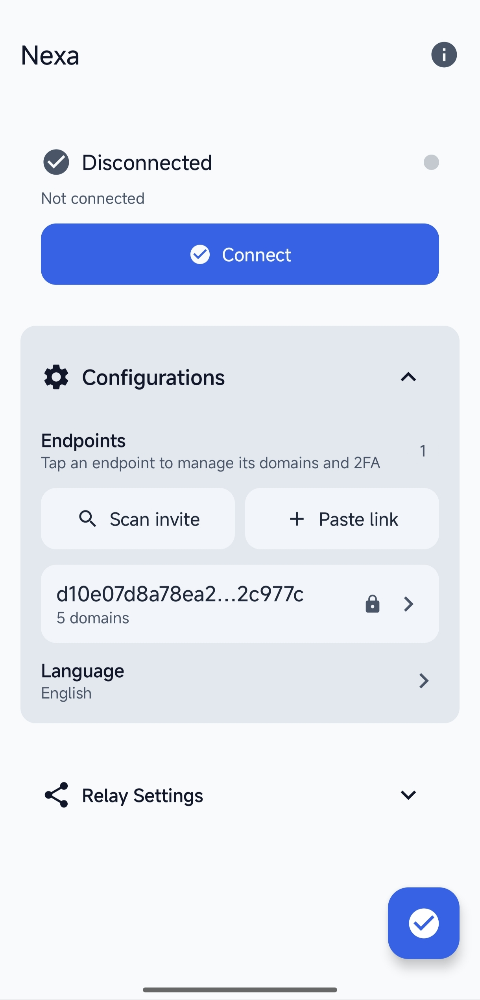
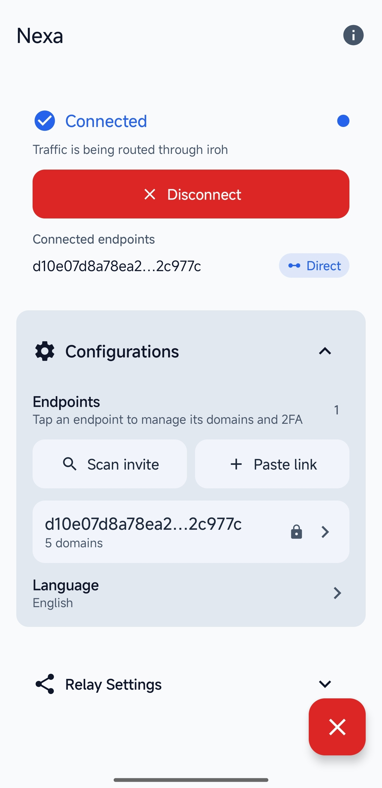
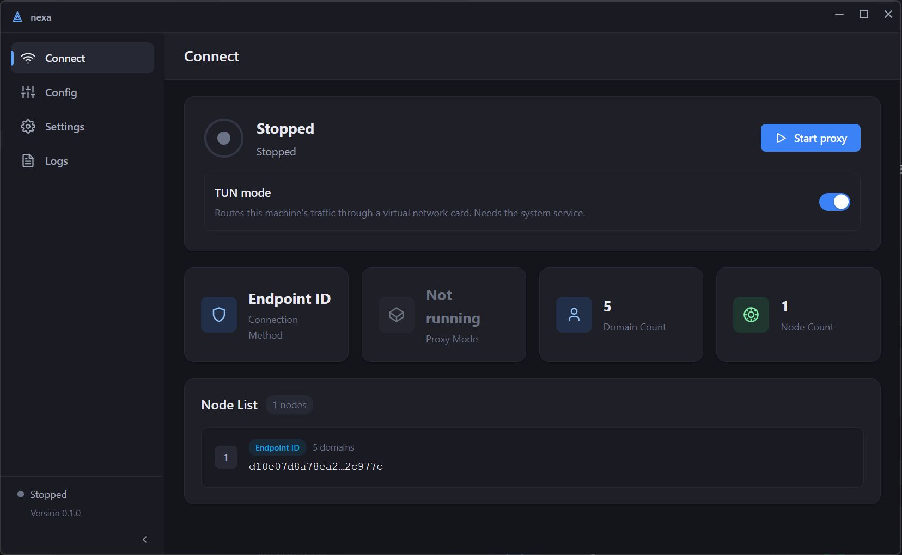
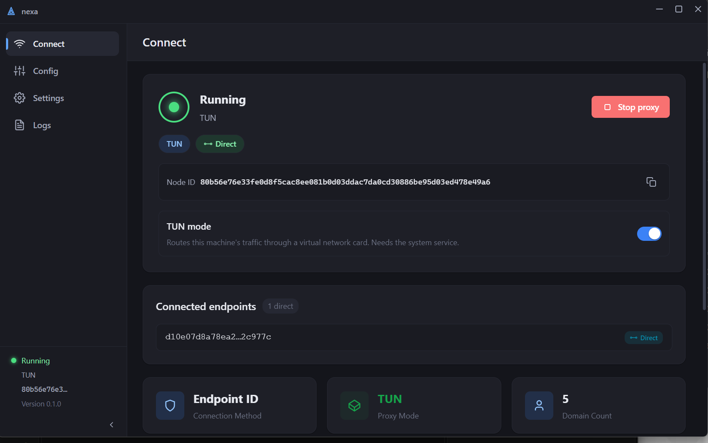

<p align="right">
  English · <a href="README.zh-CN.md">简体中文</a>
</p>

# NexaPipe

Expose HTTP, HTTPS, WebSocket, TCP and UDP services that live behind NAT through
a single [iroh](https://github.com/n0-computer/iroh) endpoint — **without ever
holding a certificate, without a control plane, and without a server to rent.**

Put plainly: **the proxy is a pipe, not a party.** It cannot read what it
carries, it is not an account you have to trust, and it does not rent anyone's
machine. See [Why NexaPipe](#why-nexapipe) for what that costs you.

NexaPipe is a Rust workspace with four parts:

- **`nexapipe`** — the server: an L7 reverse proxy plus an L4 tunnel that accept
  traffic over iroh/QUIC and forward it to your real backends. It can also serve
  plain HTTP directly. TLS is not terminated here: a client's session is passed
  through by SNI, and an `https://` backend in `http` mode is a client-side TLS
  session the server originates, not one it terminates.
- **`nexapipe-client`** — the client library: connection pooling, domain-to-node
  routing, a local HTTP proxy, and a smoltcp-based TUN proxy. Shipped as an
  `rlib`, a `cdylib` (Android JNI) and a UniFFI binding.
- **`nexapipe-proto`** — the wire format of the L4 tunnel: the `0x05` preface,
  the status byte, and UDP framing. Dependency-free, used by both sides so they
  cannot disagree about it.
- **Apps** — an Android client (`ui-android`, TUN/VpnService) and a desktop
  client (`ui-desktop`, Tauri 2 + Vue 3), both part of this repository
  (imported with their full git history from their former standalone repos).

[How it works](#how-it-works) · [Why NexaPipe](#why-nexapipe) ·
[Embed it](#embed-it-in-your-app) · [Layout](#repository-layout) ·
[Quick start](#quick-start-server) · [CLI](#cli) ·
[Configuration](#configuration) · [Minimal config](#minimal-config) ·
[TLS](#tls) · [TCP & UDP](#tcp--udp) ·
[2FA](#2fa-totp) · [Endpoint invites](#endpoint-invites) ·
[Security](#security-boundary) ·
[Client library](#using-the-client-library) · [Apps](#client-apps) ·
[Development](#development) · [Contributing](CONTRIBUTING.md) ·
[Roadmap](docs/ROADMAP.md) · [Changelog](CHANGELOG.md) ·
[v1.2.0 notes](https://open-nexa.github.io/nexapipe/v1.2.0.html)

---

## How it works

```
   clients                       nexapipe server                    your LAN / host
   ───────                       ───────────────                    ───────────────
   any HTTP client  ── TLS ───►  passthrough by SNI      ── TCP ──►  Caddy :443 (certs)
   nexapipe-client  ── QUIC ──►  L7 router (Host + path) ── HTTP ──► backend A  backend B
   (local proxy / TUN)           L4 tunnel (tcp / udp)               :18080  :15432  :3478
```

One inner TCP connection maps to one QUIC bidirectional stream. What it carries
depends on who opened it: an HTTP request (or a WebSocket upgrade), a TLS
session, or an L4 flow — a raw TCP connection or a UDP flow. For HTTP the server
routes by `Host` exactly like an ordinary reverse proxy — the NAT traversal
happens underneath and is invisible to both the app and the backend.

The **first byte** of a stream picks the handler, so the four kinds of traffic
never have to be told apart by guessing:

| First byte | Handler | Section |
| --- | --- | --- |
| `0x16` | TLS `ClientHello` → routed by SNI, forwarded as bytes | [TLS](#tls) |
| `0x05` | L4 preface → raw TCP or UDP to a named backend | [TCP & UDP](#tcp--udp) |
| anything else | HTTP request | this page |

---

## Why NexaPipe

Three properties, and what each one costs, because none of them is free.

- **It never terminates TLS.** A `ClientHello` is matched by SNI and copied
  through as bytes, so the session runs end to end between the visitor and your
  backend. What that costs: an opaque pipe cannot rewrite paths, cannot decide on
  the request, cannot probe `/health`, and its access log records bytes rather
  than a request line. (`mode = "http"` is the exception — there the proxy does
  parse the request. See [Security boundary](#security-boundary).)
- **There is no control plane.** One binary and one configuration — a
  `config.toml` or the database beside it; no account, no coordination server,
  no third party holding a map of your nodes. What that costs: no central
  device list, no remote revocation, no SSO — adding a client means editing the
  configuration (or `nexapipe client add`), which the running server picks up
  within seconds.
- **There is nothing to rent.** Clients hole-punch straight to your endpoint over
  QUIC. What that costs: hole punching succeeds for roughly 90–95% of
  connections and the rest fall back to a relay, so for anything you depend on
  you should run your own — and once you are maintaining a public machine anyway,
  "no server to rent" stops being much of an advantage.

When not to use it:

- **Your visitors cannot install anything** — NexaPipe needs a client; a hosted
  tunnel serves a plain URL to any browser.
- **You need SSO, ACLs and an audit trail** — NexaPipe authenticates a client and
  then serves every route it has.
- **A relayed connection is unacceptable** — use something with a permanent
  middle machine.

---

## Embed it in your app

The client is a library, so your own app can reach a private network without
shelling out to anything — as an `rlib`, a `cdylib` for Android JNI, and UniFFI
bindings for Swift/Kotlin/Python. See
[Using the client library](#using-the-client-library).

---

## Repository layout

| Path | What it is |
| --- | --- |
| `crates/nexapipe/` | Server binary and library: CLI (`src/main.rs`), config, iroh stream handling (`src/conn/`), HTTP/WebSocket proxying (`src/http/`, `src/proxy/`), TLS passthrough, the L4 tunnel (`src/l4/`), routing (`src/routes/`, `src/lb/`), health checks, TOTP 2FA (`src/auth/`). |
| `crates/nexapipe-client/` | Client library (`lib` + `cdylib`): pool, domain→node mapping, local proxy, L4 client, smoltcp TUN proxy, QUIC tuning, JNI, UniFFI. |
| `crates/nexapipe-proto/` | The L4 wire format: `preface.rs` and `udp.rs`. No dependencies, so both sides link the same code. |
| `ui-android/` | Android app (Kotlin + Compose). |
| `ui-desktop/` | Tauri 2 desktop app (Vue 3 + TypeScript). |
| `config.toml.example` | Example server + client configuration covering every section. It ships with 2FA **on** and no client enrolled, so a fresh install refuses every connection until one is enrolled. Copy it to `config.toml` — that name is gitignored, and the first start imports it into `nexapipe.db` beside it. The docker compose file uses `config/config.toml` instead, found via `NEXAPIPE_CONFIG_DIR=/app/config`, and keeps its database at `config/nexapipe.db`. |
| `config.toml.2fa.example` | The same, with a `[auth.clients]` entry — a client that is enrolled already. **The secret in it is published**, so it is a demonstration of what an enrolled client looks like rather than one to use: replace it with `nexapipe client enroll client-001 --force` before the listener is reachable. |
| `run_android.ps1` | One-shot Android debug loop (build → install → launch → logcat), for Windows. |
| `run_android.sh` | The same one-shot Android debug loop for macOS and Linux (bash). |

---

## Quick start (server)

```bash
cargo build --release -p nexapipe

cat > config.toml <<'EOF'               # config.toml is gitignored; this is a whole server config
[[routes]]
host_pattern = "*"
backends = ["http://127.0.0.1:3000"]    # the service you want to expose
EOF

nexapipe                                # imports ./config.toml into ./nexapipe.db, starts
```

Three lines is a working server: one catch-all route, one backend, every other key
left at its default. The client side is the same length — see
[Minimal config](#minimal-config), which also lists what each omitted key
defaults to. Start from `config.toml.example` instead when you want every
section written out, or `config.toml.2fa.example` when you want a client that
is enrolled already — and replace that client's secret before the listener is
reachable, because the one in the file is published.

Leave the file out entirely and the server writes a minimal configuration into
the store instead of refusing to start — 2FA on, nothing routed, nothing
enrolled. It is a starting point, not a working proxy:

```bash
nexapipe                                # writes ./nexapipe.db, then starts
```

Two things are true of that configuration until you change them, and both are the safe
direction: **no route**, so every host is answered 404; and **no client**, so with
`[auth] enabled = true` nothing can connect at all. Create the first client and
invite its first device with

```bash
nexapipe device invite --client client-001 --create-client
```

That prints a `nexapipe://` link and a QR code carrying a one-time enrollment
token that expires after 15 minutes (set `--ttl` to anything from `1s` to `30d`).
Scan it on the device before the deadline: the device reports its own details
when it connects and is filed under the fingerprint of its key, so there is no
name for the operator to choose. Generating a second invitation replaces the
outstanding token, which is how a link that went astray is revoked.

A store that already holds a configuration is never overwritten, and a
`config.toml` that exists but does not parse still fails the start rather than
being replaced.

On startup the server prints what clients need:

```
========================================
Proxy Connection Information
========================================
Node ID (stable, for server_node_id): 2f9c...
Ticket (for clients):                 endpoint:...
========================================
```

Give clients either the **Node ID** (stable, but it needs discovery) or the
**Ticket** (carries addresses, so it changes when they do).

**You do not have to set `[iroh] secret_key` yourself.** When it is missing, the
server generates one on the first start, writes it back under `[iroh]` — into
`config.toml` with `--storage toml`, into the database otherwise — and uses it
from then on, so the Node ID is stable from the very first run without a
copy-paste. With the file store it looks like this:

```toml
[iroh]
# written by nexapipe on first start; delete the line to have a new one made
secret_key = "8f2a…"
```

That file is rewritten through the same locked, atomic write the 2FA commands
use, so your comments and the rest of the config survive. That write creates
the file **private** (`0600`) on Unix, but the mode is no longer enforced: a
`0644` config — a Docker bind mount arrives that way — starts fine. The
credentials inside are then readable by every account, so either keep the
file private or move the key out of it (below).

Two things are worth knowing about that:

- **A `secret_key` that does not parse refuses the start.** It used to be a
  warning and a throwaway identity, which left the endpoint on a different Node
  ID after every restart while looking handled. Delete the line to have a
  working one generated, or paste the output of `nexapipe secret`.
- **A config that cannot be written still starts**, on a throwaway identity, with
  a warning — a read-only mount or a file owned by another user is an ordinary
  deployment, and refusing to start there would be worse than the fresh Node ID
  this replaces. The Node ID then changes on every restart. Set
  `NEXAPIPE_NO_PERSIST_IDENTITY=1` to ask for that deliberately and leave the
  file alone.

**The key can live outside config.toml entirely.** Point `[iroh]
secret_key_file` at a file holding just the hex key — a missing file is
generated into on first start (`0600` on Unix) — or keep it out of every file
with the environment: `NEXAPIPE_IROH_SECRET_KEY` carries the key itself,
`NEXAPIPE_IROH_SECRET_KEY_FILE` a path to a file that does (generated into the
same way when missing). A config whose key comes from outside holds no
credential, so it does not have to be private. Naming the key by more than one
source — a value and a path, the environment and the config, either and
`secret_key` — refuses the start rather than picking silently.

```bash
cargo run -p nexapipe -- secret   # only to move an identity between hosts
```

### Docker

```bash
mkdir -p config secrets logs
cp config.toml.example config/config.toml   # config.toml is gitignored
sudo chown -R 1000:1000 config secrets logs # the image runs as uid 1000
docker compose up -d --build
# The example starts with 2FA on, so nothing can connect until a client is
# enrolled. This one prints the expiring device invitation to scan.
docker compose exec nexapipe /usr/local/bin/nexapipe \
    --config /app/config/config.toml device invite --client client-001 --create-client
docker compose exec nexapipe tail -f /app/logs/nexapipe.log
```

The example ships with 2FA on and no client enrolled, so the server starts and
then refuses every connection until a client is enrolled — `device invite
--client client-001 --create-client` above creates the client and prints a
one-time enrollment link that expires after 15 minutes. It writes the client and
the token, with its deadline, into the config file; the first device that scans
the link before the deadline trades the token for a credential of its own, and
the link stops being a credential at that moment. Generating another invitation
revokes the outstanding one.

`docker-compose.yaml` mounts a `config/` directory — the one holding your
`config.toml` — a `secrets/` directory for the endpoint identity, and a `logs/`
volume, and points `NEXAPIPE_LOG_DIR` at the logs volume. The `secrets/` mount
goes with `NEXAPIPE_IROH_SECRET_KEY_FILE=/app/secrets/iroh.key`: the endpoint
key is generated into that file on the first start (`0600`), so `config.toml`
itself holds no private key. Back `secrets/` up with `config/` — losing it
means a new Node ID on the next start, and clients that stored the old one stop
finding the server.
It also sets `NEXAPIPE_CONFIG_DIR=/app/config`, so the binary inside the
container finds `/app/config/config.toml` by default — the same file the host
sees at `config/config.toml`. The database is `/app/config/nexapipe.db`, inside
the same mount, so the configuration and its counters are backed up together.
`--config` still wins, so an operator can point at any path. `host.docker.internal` is configured, so backends running
on the Docker host are reachable. Moving an existing deployment over is one
command: `mkdir -p config && mv config.toml config/config.toml`.

The image runs as **uid 1000, not root** — the proxy needs no privileges, and a
server reachable from the internet holding the 2FA seeds and the endpoint
identity should not be root. The three mounted directories therefore have to be
writable by that uid, which is what the `chown` above is for: `mkdir` leaves
them owned by whoever ran it, and that is uid 1000 only by coincidence.
**Upgrading a deployment that ran the root image** needs the same command
before the first start, and it needs `sudo` — the files the old image wrote
are root-owned:

```bash
sudo chown -R 1000:1000 config secrets logs
```

Skipping it does not always fail loudly. A `config.toml` the new user cannot
write costs every 2FA counter update, and an `iroh.key` it cannot open is
*regenerated* — which is a new Node ID, and every client that stored the old one
stops finding the server.

Published images are on GHCR (`linux/amd64` and `linux/arm64`), named the same
as what `docker-compose.yaml` builds. To run one instead of building locally,
pull it and start the stack **without** `--build` — `--build` rebuilds from the
`Dockerfile` whatever is already there:

```bash
docker pull ghcr.io/open-nexa/nexapipe:latest
docker compose up -d
```

Pinning a version instead of following it: replace `:latest` with a tag such as
`:1.0.0` in both lines, or set `image:` in a `docker-compose.override.yml` so
you are not editing a tracked file. `latest` only ever follows releases; a
pre-release tag never takes it.

#### Checking the published image

Every published image carries a signature and a provenance attestation, so
"the image on GHCR is the one this repository built" is something you can
check rather than something you are told. The signing key is minted for the
release run through GitHub's OIDC, so it is never stored anywhere and cannot
be copied out of a secret.

```bash
cosign verify ghcr.io/open-nexa/nexapipe:latest \
    --certificate-identity-regexp 'https://github\.com/open-nexa/nexapipe/\.github/workflows/release\.yml@refs/tags/v.*' \
    --certificate-oidc-issuer 'https://token.actions.githubusercontent.com'
```

The identity above is the tag the release was published from. If a release is
re-run by hand, dispatch the workflow against the tag itself (`Run workflow` →
the tag), not a branch: a run started from a branch signs with
`refs/heads/<branch>` as its identity, and this command rejects that on
purpose.

The attestation says what was built and from which source revision. It is
looked up by digest, and the digest is what the tag resolves to:

```bash
docker buildx imagetools inspect ghcr.io/open-nexa/nexapipe:latest
gh attestation verify oci://ghcr.io/open-nexa/nexapipe@sha256:<digest> \
    --repo open-nexa/nexapipe
```

Neither step changes what you pull — a tag is still a tag. They are there for
the reader who would rather check than trust.

#### Editing the config file

The file is re-read every 5 seconds, so an edit needs no restart — but **run
anything that writes it inside the container**:

```bash
# The image's own binary, against the file the server is actually reading.
docker compose exec nexapipe /usr/local/bin/nexapipe \
    --config /app/config/config.toml device invite --client client-001
```

Running the same command on the host against the bind-mounted file is where it
goes wrong:

- **Keep the mount a directory.** A single-file bind mount is pinned to the
  inode the path had when the container started, so anything that replaces the
  file — `sed -i`, an editor with atomic save, `mv` — leaves the container
  reading the copy that was swapped out: the change never arrives and nothing is
  logged. `docker compose restart` does not help, because it does not rebuild
  the mount; `docker compose up -d --force-recreate` does. The compose file
  mounts `./config:/app/config` for exactly this reason — a directory mount is
  resolved by name on every lookup, so it always sees the current file. Putting
  `./config.toml:/app/config/config.toml` back reintroduces the trap.
- **Two writers, no lock.** The server rewrites the whole file to file an
  enrollment (`pending_enrollment`). Every write on both sides is a
  read-modify-write with no locking, so an overlapping host edit and flush lose
  one of them. A `pending_enrollment` token is the worst case: the server never
  writes it back, so losing the race costs you the invite and prints nothing.
  The 2FA counters used to be in this list too — the server rewrote the file to
  persist `failed_attempts` / `locked_until` / `last_used` whenever a 2FA
  attempt happened. They live in a state file of the server's own now
  (`config.state.toml`, beside the configuration), so that race is gone with
  them.
- **The host binary is not the server's binary.** Both invite commands derive the
  endpoint from `[iroh] secret_key`, so a `nexapipe` built from another commit
  than the running one can issue an invite pointing at an endpoint nobody is
  running. (A config *without* the key used to be a way to hit this too; the
  server now writes one on first start, so the key is there.)
- **Mode and ownership change under you.** A rewrite from the host can land the
  file at `0644` or with a different owner. That no longer stops the server —
  config permissions are not checked — but any account that can read the file
  can copy every credential in it, so keep it private or move the credentials
  into a sidecar file or the environment.

The mount is read-write on purpose: the server writes `[iroh] secret_key` into
`config.toml` on the first start, and the 2FA counters into `config.state.toml`
beside it after every attempt, so a `:ro` mount would cost a lockout its persistence
and log an error on every attempt — and leave the Node ID changing on every
restart. Set `NEXAPIPE_NO_PERSIST_IDENTITY=1` if the config genuinely has to stay
read-only, and pin `[iroh] secret_key` by hand in that case, so the identity at
least survives.

Editing with an editor is fine as long as it saves in place — the default for
`vim` and for a shell `>` redirect. Whatever you changed, confirm the server
took it instead of assuming it did:

```bash
docker compose logs -f --tail=50 nexapipe | grep -i reload
# Detected config change, reloading...  →  Config reloaded: 3 routes now live
# Config not reloaded, keeping the current routes: ... → refused, old routes still serve
```

### systemd

The commands above leave the server in the foreground of whichever shell started
it. To run it as a service, install the binary and give it an account:

```bash
sudo install -m 0755 target/release/nexapipe /usr/local/bin/nexapipe
sudo useradd --system --shell /usr/sbin/nologin nexapipe
sudo mkdir -p /etc/nexapipe
sudo cp config.toml.example /etc/nexapipe/config.toml
sudo chown -R nexapipe:nexapipe /etc/nexapipe
sudo chmod 700 /etc/nexapipe
# Recommended hardening; no longer required for the server to start.
sudo chmod 600 /etc/nexapipe/config.toml
```

The example ships with 2FA on and no client enrolled, so the service starts and
then refuses every connection until a client is enrolled. Create the first one
and invite its first device before pointing a device at it:

```bash
sudo -u nexapipe nexapipe \
    --config /etc/nexapipe/config.toml device invite --client client-001 --create-client
```

The invitation expires after 15 minutes by default (`--ttl` accepts `1s`..`30d`),
and a second `device invite` revokes the outstanding one. Scan it before the
deadline: the device reports its own details and is filed under the fingerprint
of its key.

It has to run as the account the service runs as: the config is written by
writing a new file and renaming it over the old one, so a file written by root
belongs to root, and a service that cannot read its own config is a service
that is down.

Then `/etc/systemd/system/nexapipe.service`:

```ini
[Unit]
Description=NexaPipe server
Documentation=https://github.com/open-nexa/nexapipe
After=network-online.target
Wants=network-online.target

[Service]
Type=simple
User=nexapipe
Group=nexapipe
ExecStart=/usr/local/bin/nexapipe --config /etc/nexapipe/config.toml
Restart=on-failure
RestartSec=5s

# Read only if it exists: the leading `-` is what makes it optional. Besides
# NEXAPIPE_LOG_DIR and NEXAPIPE_MAX_CONNS_PER_PEER, the iroh key and relay
# token can be supplied from the environment or a sidecar file, so a read-only
# config does not have to carry credentials.
EnvironmentFile=-/etc/nexapipe/nexapipe.env

# ProtectSystem=strict makes every path read-only except the ones named here.
# The config directory has to stay writable; see the second note below.
ReadWritePaths=/etc/nexapipe
LogsDirectory=nexapipe

# Only for a [server] listen_addr below 1024. The tunnel holds no privileged
# port, and a non-loopback listener is refused while [auth] is on, so most
# deployments leave both of these commented out.
#AmbientCapabilities=CAP_NET_BIND_SERVICE
#CapabilityBoundingSet=CAP_NET_BIND_SERVICE

NoNewPrivileges=yes
PrivateTmp=yes
ProtectSystem=strict
ProtectHome=yes
ProtectProc=invisible
# AF_UNIX because a hostname in `backends` still goes through the C library's
# resolver, which some configurations answer from a local socket: a family the
# unit does not list is a name that fails to resolve, not a warning.
RestrictAddressFamilies=AF_INET AF_INET6 AF_UNIX

[Install]
WantedBy=multi-user.target
```

```bash
sudo systemctl daemon-reload
sudo systemctl enable --now nexapipe
sudo systemctl status nexapipe
journalctl -u nexapipe -f
```

**A named account rather than `DynamicUser=yes`.** This process owns files under
`/etc/nexapipe` — the config it rewrites and the token it writes beside it — and
a dynamic user is for a service that owns nothing outside the directories
systemd makes for it. systemd allocates that UID for one start and can hand the
same one to a different service later, which is why it relocates
`StateDirectory`, `CacheDirectory` and `LogsDirectory` of its own accord: a
credential file in `/etc` is not one of them.

**The config directory has to stay writable.** The server writes back into the
store: `config.toml` with `--storage toml`, `nexapipe.db` beside it otherwise —
where an enrolled device's secret, the admin token, the 2FA counters
(`failed_attempts`, `locked_until`, `last_used`) and the endpoint key all end up.
With `--storage toml` the token is `config.toml.admin-token` and the counters are
`config.state.toml`, both beside the file. On the very first start it writes
there too, adding `[iroh] secret_key` when the configuration has none: a
deployment that never enrolls a client still needs the directory writable, or
the Node ID changes on every restart. `ReadWritePaths` is that one
directory and nothing wider. `NEXAPIPE_NO_PERSIST_IDENTITY=1` is the way to run
without a writable config, at the cost of a Node ID that does not survive a
restart.

**Keep it `0600` and owned by `nexapipe`, after every edit — recommended, not
enforced.** Config file permissions are no longer checked, so a `0644` config
starts, but one holding `[auth]` secrets, an `[iroh] secret_key` or a
`relay_auth_token` then hands every credential to any account that can read
the file. Prefer moving those into a sidecar file (which is still enforced
`0600`) or the environment. Editing as root is the ordinary way a private mode
gets lost: `sudo -u nexapipe $EDITOR /etc/nexapipe/config.toml`, or `chown`
and `chmod` when you did not.

**A config edit needs no reload.** The file is re-read every 5 seconds, and
`systemctl reload` against a unit with no `ExecReload` gets you a warning and
nothing else. The watcher is also what refuses a bad edit: a change that does
not parse is reported and the routes already serving stay up.

Two things that are not systemd's. **Open the tunnel's UDP port** — set `[iroh]
bind_port`, because without it the endpoint takes an ephemeral one and there is
no port to write a rule for. And **run `nexapipe status` as an account that can
read the token file**, since that is where it reads the token from:

```bash
sudo -u nexapipe nexapipe --config /etc/nexapipe/config.toml status
```

`[log]` files are separate from the journal, and `dir` defaults to `./logs`
relative to the working directory — which under systemd is `/`, so the default
names a directory the service cannot create. It is not fatal: one line on stderr
and file logging is off for that run. Point it at the directory the unit owns:

```toml
[log]
dir = "/var/log/nexapipe"      # LogsDirectory=nexapipe above creates and owns it
```

**The unit above has not been run in this project's CI** — the same caveat
`docs/self-hosted-relay.md` makes about the relay's. The directives are not all
the same age, and systemd ignores one it does not recognise with a line in the
journal rather than refusing to start: `ProtectProc=invisible` needs 247,
`StateDirectory=` and the rest of the `*Directory=` family 235, and
`ProtectSystem=strict` 232. On something older the unit comes up anyway with the
protections it could not read quietly missing, which `systemd-analyze verify`
will name.

---

## CLI

Every request is a command. `nexapipe` on its own starts the server — which is
what `nexapipe serve` does as well — and every other command runs and exits.

| Command | Meaning |
| --- | --- |
| `nexapipe [serve] [--local-proxy]` | Start the server. `--local-proxy` runs the client-side local HTTP proxy instead. |
| `nexapipe status [--json]` | Ask the instance at `[admin] listen_addr` what it is doing. |
| `nexapipe client list [--json]` | The clients in `[auth.clients]` and the devices of each. **No secret is printed** — that is what `client qr` is for. |
| `nexapipe client add <CLIENT_ID> [--public-key HEX] [--force]` | Issue a credential: the client's own `secret`, or a key for one device. Refuses to replace one without `--force`. |
| `nexapipe client revoke <CLIENT_ID> [--device DEVICE_ID]` | Drop a client and every credential under it, or only one device's. |
| `nexapipe client enroll <CLIENT_ID> [--force]` | Generate a TOTP secret, write it into the configuration and print the enrollment QR code. A client that already has a secret keeps it unless `--force` rotates it. |
| `nexapipe client qr <CLIENT_ID>` | Print the QR code of the secret a client already has, writing nothing. |
| `nexapipe device invite --client <CLIENT_ID> [--ttl 15m] [--domains a,b] [--relay URL] [--create-client]` | Print a one-time device invitation: a `nexapipe://` link and QR carrying an `enroll=` token with an `exp=` deadline. See [`nexapipe device`](#nexapipe-device). |
| `nexapipe invite [CLIENT_ID] [--create-client] [--domains LIST] [--name NAME] [--relay URL] [--ticket TICKET] [--endpoint-id ID]` | Print the endpoint invite. With a `CLIENT_ID` it carries that client's 2FA credential too; without one, only the endpoint and its domains. |
| `nexapipe qr <TEXT>` | Draw a QR code carrying the text given — a link, a ticket, anything — and write it to `--out` when that is given. |
| `nexapipe secret` | Print a new iroh secret key, and write nothing. Usually unnecessary: the server writes `[iroh] secret_key` on first start; this is for moving an identity between hosts. |
| `nexapipe config show` | Print the configuration the store holds, in the format it is written in. |
| `nexapipe config path` | Print the store that holds the configuration — the file, or the database. |

The settings that mean the same thing whichever command runs stay global:

| Option | Meaning |
| --- | --- |
| `-c, --config <PATH>` | Where the configuration is (default `./config.toml`; `NEXAPIPE_CONFIG_DIR` shifts it). The file store reads this file; the database store derives `nexapipe.db` from its directory. |
| `--storage <KIND>` | `sqlite` (default) or `toml`; `NEXAPIPE_STORAGE` says the same thing. See [Where the configuration is kept](#where-the-configuration-is-kept). |
| `--storage-url <URL>` | Where the database is (default: `nexapipe.db` beside `--config`); `NEXAPIPE_STORAGE_URL` says the same thing. |
| `--issuer <NAME>` | Issuer label shown by the authenticator app. |
| `--format <FMT>` | How to draw the QR code: `unicode` (default), `plain`, `ascii`, `svg`, `none`. The older spelling is `--qr-format`. |
| `--invert` | Draw the QR code inverted (light on dark). The older spelling is `--qr-invert`. |
| `--out <PATH>` | Also write the QR code to a file (`.svg` → SVG, anything else → ASCII). The older spelling is `--qr-out`. |
| `--endpoint-id <NODE_ID>` | Endpoint to publish (default: derived from `[iroh] secret_key`). Requires lookup: the client resolves it through discovery. When the configuration names this server's identity, the endpoint has to be this server's own: an invite that would carry this server's 2FA credential to another endpoint is refused. |
| `--invite-ticket <TICKET>`, `--ticket <TICKET>` | Publish a full endpoint ticket (as printed at server start) instead of a Node ID. The addresses ride in the link, so the invite works with `[iroh] discovery = "none"`. Conflicts with `--endpoint-id`. It has to be this server's own ticket: an invite that would carry this server's 2FA credential to another endpoint is refused. |

### The older spellings

Every flag this binary had before the command groups keeps working for one
release, hidden from `--help`, and prints one line on stderr naming the command
that replaced it. Two spellings were retired before that and stay retired:
`--registration` and `client add --device`, which refuse and point at
`nexapipe device invite --client <CLIENT_ID>`.

| Old flag | Command |
| --- | --- |
| `--local-proxy` | `nexapipe serve --local-proxy` |
| `--generate-secret` | `nexapipe secret` |
| `--generate-2fa <CLIENT_ID>` | `nexapipe client enroll <CLIENT_ID>` |
| `--force` | `nexapipe client enroll <CLIENT_ID> --force` |
| `--show-2fa <CLIENT_ID>` | `nexapipe client qr <CLIENT_ID>` |
| `--generate-invite [CLIENT_ID]` | `nexapipe invite [CLIENT_ID]` |
| `--create-client` | `nexapipe invite --create-client` |
| `--invite-domains <LIST>` | `nexapipe invite --domains <LIST>` |
| `--invite-name <NAME>` | `nexapipe invite --name <NAME>` |
| `--invite-relay <URL>` | `nexapipe invite --relay <URL>` |

`--qr-format`, `--qr-invert` and `--qr-out` are aliases of the drawing options
above rather than deprecated flags, so they print no notice.

### `nexapipe device`

Device enrollment is an invitation with a deadline, not a name picked by the
operator. A device is known by the fingerprint of its key and reports its own
`label`, `platform`, `model` and `app_version` when it connects — duplicate
labels are allowed, because the label is for reading, not for addressing.

| Command | Meaning |
| --- | --- |
| `device invite --client <CLIENT_ID> [--ttl 15m] [--domains a,b] [--relay URL] [--create-client]` | Print a `nexapipe://` link and QR carrying a one-time `enroll=<token>` and an `exp=<unix>` deadline. The server writes `pending_enrollment` and `pending_enrollment_expires_at` into the config before printing it. The first device to scan before the deadline enrolls and the link is spent; generating another invitation revokes the outstanding one. `--ttl` accepts `1s`..`30d`. |

The device is filed under `d-` plus the first 16 hex characters of the SHA-256 of
its Ed25519 public key, for example `[auth.clients.client-001.devices.d-9f2c1a4b7e0d3f58]`.
See [Device invitations](#device-invitations) for the flow and the link format.

### `nexapipe client`

The write half of the management surface, as subcommands rather than
`POST /v1/clients`: the admin token is one opaque value with no scope and no
rotation, and giving it something to change is how a read-only surface becomes
the way into the credential store. Each one edits the config file under the same
lock the server takes, and a running server picks up the change on its next
reload.

| Command | Meaning |
| --- | --- |
| `client list [--json]` | The clients in `[auth.clients]` and the devices of each. **No secret is printed** — that is what `client qr` is for. JSON includes `invite_expires_at` and each device's `label`/`platform`/`model`/`app_version`. |
| `client add <CLIENT_ID>` | Issue a credential: writes the client's own `secret`, which is the credential of a device with no row of its own. Refuses to replace one without `--force`. |
| `client add <CLIENT_ID> --device <NAME>` | **Removed** — it now fails with a pointer to `device invite`. Devices are identified by the fingerprint of their key, not a name the operator picks; re-enroll old name-keyed devices with a fresh invitation. |
| `client add <CLIENT_ID> --public-key <HEX>` | Issue a **key** instead of a secret: the public half of an Ed25519 pair (64 hex chars). The device id is derived from the key fingerprint (`d-` plus 16 hex chars), so no `--device` is needed or allowed. No secret is written and none is printed — there is none. See [Device keys](#device-keys). |
| `client revoke <CLIENT_ID>` | Drop a client and every device credential under it. |
| `client revoke <CLIENT_ID> --device <DEVICE_ID>` | Drop one device's credential, keeping the client and its other devices. |

```bash
nexapipe client list --config config.toml
nexapipe device invite --client laptop-1 --config config.toml
nexapipe client revoke laptop-1 --device d-9f2c1a4b7e0d3f58 --config config.toml
```

A revoke deletes rather than rewriting, because a missing entry is what the
handshake reads as "this device has no credential" — the same answer a device
that never enrolled gets, so what happened to it cannot be told from outside.

What those commands read and write is a `devices` table beside the client's own
`secret`. A device row is keyed by the device id — `d-` plus the first 16 hex
characters of the SHA-256 of its Ed25519 public key — and carries the details the
device reported when it enrolled:

```toml
[auth.clients.client-001]
secret = "JBSWY3DPEHPK3PXP"        # the credential of a device with no row of its own

[auth.clients.client-001.devices.d-9f2c1a4b7e0d3f58]
public_key = "a1b2…f0e9"            # 64 hex chars, the public half of the device's key
label = "laptop"                    # human name the device reported, not an identity
platform = "linux"
model = "ThinkPad X1"
app_version = "1.2.0"
created_at = "1723756800"
```

The label is what the operator reads, not how the device is addressed, so two
devices may report the same label. Rows are now filed under the key fingerprint.
A name-keyed row is a legacy entry: to move that device onto the new scheme,
revoke the old row and scan a fresh invitation to re-enroll it. Nothing here has
to be written by hand: enrollment files the device on its own, and
`client add <id> --public-key <HEX>` registers a key from the shell. A client
carrying no `devices` table authenticates as it always did, and a device with no
row of its own answers with the client's `secret`. See [Device keys](#device-keys).

---

## Configuration

`config.toml` describes the server and the client mode. Every key is optional.

**Where that configuration is kept depends on the store.** A deployment that
says nothing keeps it in a SQLite database called `nexapipe.db`, in the
directory `--config` names — `./config.toml` puts it in `./nexapipe.db`, and
`/etc/nexapipe/config.toml` in `/etc/nexapipe/nexapipe.db`. One anchor, so the
configuration, its lockouts and its token are one directory to back up. See
[Where the configuration is kept](#where-the-configuration-is-kept).

The configuration is re-read every 5 seconds and applied live: `[[routes]]` and the
`[auth.clients]` table need no restart, and a config
that fails to parse or validate is reported and ignored, so a half-saved edit
cannot take the proxy down. The rest is read once at startup and needs a restart:
`[server] listen_addr`, `[iroh]`, `[peers]`, the `[auth]` TOTP parameters and
`[log]`.

An `[auth]` section can appear where there was none, too: a server started
without one still picks up its `clients` — and `enabled = true` — from a later
reload, so enabling 2FA for the first time does not need a restart.

Two changes are deliberately one-way on a running server: `[auth] enabled = true`
is picked up by the watcher, but turning 2FA *off* is refused (restart to
disable it), and `enabled = true` together with an exposed plaintext listener is
refused outright.

### Where the configuration is kept

The store is chosen on the command line, never in the configuration itself — a
document cannot say where it lives, because it is read from there first.

| Store | How to ask for it | Where it lives |
| --- | --- | --- |
| SQLite (default) | nothing, or `--storage sqlite` | `<directory of --config>/nexapipe.db` |
| File | `--storage toml` | the path `--config` names |

`NEXAPIPE_STORAGE` says the same thing for a deployment that cannot change its
command line, and `--storage-url` / `NEXAPIPE_STORAGE_URL` moves the database
somewhere else — that URL wins over the derived path:

```bash
nexapipe --config /etc/nexapipe/config.toml                       # /etc/nexapipe/nexapipe.db
nexapipe --config /etc/nexapipe/config.toml --storage toml        # the file, no database
nexapipe --config /etc/nexapipe/config.toml --storage-url /srv/nexapipe.db
```

The database holds the whole configuration — routes, clients, devices,
per-client counters, the admin token and the endpoint key — so there is no
`config.state.toml` and no `config.toml.admin-token` beside it. The file store
keeps those two, as it always has (see [the next
section](#the-file-store-is-three-files)).

**A `config.toml` from an earlier version is imported once.** The first start
that finds an empty database and a `config.toml` beside the path `--config`
names writes that file's configuration into the database, and says so in the
log:

```
Imported the configuration from /etc/nexapipe/config.toml into /etc/nexapipe/nexapipe.db;
this instance reads the store from now on. The file is left where it is — `--storage toml`
reads it again — so editing it no longer changes this configuration
```

The file is **not** moved or deleted: `--storage toml` still reads it, which is
what makes going back a flag rather than a recovery. A file that cannot be
parsed stops the start with the reason and leaves the database empty, rather
than half-applying it.

The import is a **server-start** step, not something every command does: a
`client list` against an empty database reports that there is no configuration
instead of migrating behind your back, because a command that only reads should
not write.

A build made with `--no-default-features` carries no database driver. It stays
usable — it is the file-only server — but it has to be told `--storage toml`, and
it refuses the database by name rather than falling back to a file the
deployment may not have.

### The file store is three files

With `--storage toml`, `config.toml` is the operator's file: what they wrote,
what they read, what they keep in version control. The things a running server
learns — how many times a client mistyped a code, until when it is locked out,
when it was last seen — are not that, so they live in a state file **beside** the
configuration, in the same shape and with the same client ids and device ids.

```
/etc/nexapipe/
├── config.toml          the operator's file
├── config.state.toml    the server's counters (0600, written by the server)
└── config.toml.admin-token
```

The state file is named after the configuration: `config.toml` puts its state
in `config.state.toml`, and `config.prod.toml` in `config.prod.state.toml`, so
two configurations in one directory do not share their lockouts. A `state.toml`
beside the configuration is still read when the named file is not there yet,
which is where a deployment that predates the naming rule keeps its counters.

The state file is written by the server and by nobody else, and the
configuration file is never rewritten for the counters. That separation is not
only tidiness: the server watches the configuration's modification time, so a
server that wrote its counters into the configuration turned every mistyped code
into a configuration reload — the routes rebuilt and the health checks
restarted, because a stranger typed a code wrong.

Nothing has to be set up. The state file appears the first time a client
mistypes a code or authenticates, and it is `0600`. A state file that cannot be
read stops the server from starting: the lockouts it holds would be unknown, and
starting anyway would reset every one of them. Delete it to start without the
lockouts it holds.

A configuration written before the state file existed still works: the three
counter keys are read from it, so a deployment that was counting there keeps its
lockouts until the state file has an entry for that client. They are not written
back there any more.

### Minimal config

A whole **server** — one catch-all `http` route to one backend:

```toml
[[routes]]
host_pattern = "*"
backends = ["http://127.0.0.1:3000"]
```

A whole **client** (`nexapipe --local-proxy`), turning `127.0.0.1:8081` into an
HTTP proxy that tunnels the listed domains:

```toml
[local_proxy]
enabled = true
listen_addr = "127.0.0.1:8081"
proxy_domains = ["app.example.com"]

[[local_proxy.nodes]]
server_node_id = "<the Node ID the server printed>"
domains = ["app.example.com"]
```

What the short forms leave out, and what you get instead:

| Omitted | You get |
| --- | --- |
| `[server] listen_addr` | no plaintext listener — traffic comes in over iroh only |
| `[iroh] secret_key` | a stable Node ID, written into the config on first start if you leave it out. Set `NEXAPIPE_NO_PERSIST_IDENTITY=1` for the old behaviour (a fresh Node ID every restart, config untouched) |
| `[iroh] relay_mode` | `default`: N0 relays, home relay picked by latency |
| `mode` | `http` |
| `path_pattern` | `/`, prefix match — a prefix ends at a segment boundary, so `/api` covers `/api/x` and not `/apifoo` |
| `strategy` | `round_robin` (or `random`, or `least_conn` — fewest requests outstanding to that backend) |
| `[health_check]` | enabled: `GET {backend}/health` every 10 s. A backend with no such endpoint is logged as failing, but **traffic still flows to a route with one backend** — there is nothing to choose between — so that is log noise, not an outage. A route with several, all down, answers 503 without dialling. Set `enabled = false` to silence it. |
| `[log]` | rotating files under `./logs` plus console output, query values redacted |
| `[auth]`, `[peers]` | no authentication — the server prints a warning banner at startup. Fine on a laptop; add `[peers] allow` (or 2FA) before this faces anything you care about. |

Everything below this section is optional. Two keys are not: a route needs
`host_pattern` and `backends`, and a `[local_proxy]` block needs `listen_addr`
and `proxy_domains`.

### Top level

`debug` (default `false`) turns on debug logging.

**There is no fallback.** A host no route names is answered 404 over HTTP, and
refused outright by `passthrough`, `tcp` and `udp` lookups. "Send everything
here" is spelled as a catch-all route — `host_pattern = "*"` — which is
load-balanced and health-checked like any other route. The old top-level
`default_backend` has been **removed**: a config that still names it is refused
at startup rather than silently ignored, so an existing config cannot quietly
start answering 404 where it used to forward.

A wildcard has to be `*` on its own or start with `*.`: the dot is what marks
the label boundary, and without it `*.example.com` would also match
`notexample.com` — a host that merely ends in the same letters and belongs to
somebody else. A pattern like `*example.com` is refused at startup, in
`host_pattern` and in a client's `allow_hosts` alike.

**The client's list of names is spelled the same way**, so a pattern can be
copied from one list to the other: `app.example.com` is that name and nothing
else, `*.example.com` is its subdomains and not the name itself, and `*` is
every name. The two used to disagree — the client read a bare domain as the
name *and* every subdomain, while the server read it as the name alone — so a
subdomain the client put in the tunnel was a name the server had no route
for, and the failure looked like the tunnel was broken. A client that still
carries an older list says so in its log, once, at startup.

### `[server]` — direct ingress (off by default)

| Key | Default | Notes |
| --- | --- | --- |
| `listen_addr` | *unset — not bound* | Plain HTTP listener. A TLS session opened against it is passed through, not terminated. |
| `expose` | `false` | Required for `listen_addr` to name anything but loopback. Refused at startup while `[auth] enabled = true`. |

**Nothing on this listener is authenticated**: the 2FA handshake runs in the iroh
accept loop, so a request arriving here reaches a route without ever being asked
for a credential. Leave `listen_addr` unset (the default) or keep it on
`127.0.0.1` for something on the same host; a non-loopback bind additionally
needs `expose = true` and publishes every `http` route and every `passthrough`
backend to whoever can reach the port. `expose = true` together with
`[auth] enabled = true` is **refused at startup** — with 2FA on, the combination
reads as a protected proxy but is not one. (Older versions logged a warning and
started anyway.)

One difference from the tunnel path: **WebSocket upgrades are proxied over iroh
but answered `426 Upgrade Required` here** — the listener has no WebSocket
client. Clients that need WebSocket must come through the tunnel.

`tls_enabled`, `tls_listen_addr`, `cert_path` and `key_path` are still accepted
so an existing `config.toml` parses, but they do nothing and are reported at
startup — delete them and see [TLS](#tls).

### `[iroh]` — the tunnel endpoint

| Key | Notes |
| --- | --- |
| `secret_key` | Optional. The server generates one on first start and writes it here when absent, so the Node ID is stable without you setting it. Set it by hand only to move an identity between hosts, or to keep one when the file cannot be written. A value that does not parse refuses the start. |
| `bind_port` | Fixed UDP port instead of an ephemeral one. |
| `bind_ipv6` | Also bind `[::]` on that port, so the endpoint answers over IPv6. The IPv4 socket stays — this adds one, it does not replace one — and the IPv6 bind is allowed to fail, so a host without IPv6 still starts. Ignored without `bind_port`. |
| `relay_mode` | `pinned` / `default` / `disabled` / `custom`. Absent means `default`. |
| `relay_url` | The relay to use with `relay_mode = "custom"`; setting it without a `relay_mode` means `custom`. |
| `relay_auth_token` | Optional bearer token for a `custom` relay that requires one. |
| `discovery` | `n0` / `none`. Absent means `n0`. `none` switches off the address lookup that turns a Node ID into an address, so nothing about this endpoint reaches `dns.iroh.link` — at the price of a Node ID no longer being enough to reach it (a ticket carries an address). A value that is present but unknown refuses the start. |

Relay modes:

- **`default`** — every N0 relay, home relay chosen by latency. It can migrate
  between relays, which drops the connections routed through it.
- **`pinned`** — one fixed N0 relay (`aps1-1`, Singapore). Use when relay
  migration is worse than a slightly slower relay.
- **`disabled`** — no relay transport at all. Stronger than it sounds: you also
  cannot dial a peer through *its* relay.
- **`custom`** — one relay you run, and only that one: no N0 relay is used,
  neither as a home relay nor as a probe target. Pointing it at an
  `*.relay.n0.iroh.link` URL is rejected; use `pinned` or `default` for those.
  [Running your own relay](docs/self-hosted-relay.md) covers the other half of
  this mode — getting that server up in the first place.

A `relay_mode` that is present but unusable — `custom` with no URL, an
unrecognised spelling — stops startup instead of quietly falling back. A
`relay_url` next to a mode that does not take one is ignored and logged.

**Two settings finish the job.** `relay_mode` covers the relay; Endpoint ID
discovery — the lookup that turns a Node ID into "where do I send QUIC
packets" — is a separate switch, `discovery = "none"`, and it is what keeps a
lookup from going to `dns.iroh.link`. A `custom` client also refuses to dial a
peer through anybody else's relay, so a peer that carries an address is
reached through your relay and nothing else. A peer named only by a Node ID
still needs the lookup to be found at all, so it is dialled while the endpoint
may ask n0 where it is — and refused outright once the lookup is off.
[What still depends on third-party infrastructure](docs/iroh-boundaries.md)
states the boundary in full, including what each of these does and does not
buy.

### `[[routes]]` — routing

```toml
[[routes]]
host_pattern = "comfyui.example.com"
path_pattern = "/"
path_is_prefix = true
strategy = "round_robin"          # or "random" or "least_conn"
backends = ["http://192.0.2.20:18188"]
mode = "http"                     # default
# path_rewrite = "/api"
# backend_protocol = "h2c"        # HTTP/2 in the clear; see below

[[routes]]
host_pattern = "app.example.com"
mode = "passthrough"              # TLS, routed by SNI; see TLS below
backends = ["caddy:443"]

[[routes]]
host_pattern = "db.example.com"   # a raw TCP service, any port
mode = "tcp"
backends = ["192.0.2.30:15432"]

[[routes]]
host_pattern = "turn.example.com"
mode = "udp"                      # UDP flows, idle timeout in seconds
backends = ["192.0.2.40:13478"]
idle_timeout_secs = 60

# One host that has to answer both a request and a tunnel — the ordinary shape
# for an Android TUN client. `modes` takes several; `mode` takes one.
[[routes]]
host_pattern = "app.example.com"
modes = ["http", "tcp"]
backends = ["http://host.docker.internal:18080"]
```

| Mode | What it does | Transport security |
| --- | --- | --- |
| `http` (default) | Parses the request, applies `path_pattern` / `path_rewrite`, and re-issues it with the shared HTTP client. A backend may be `http://` or `https://`. An `https://` one is reached over a TLS session the server originates and verifies against the machine's trust store — the server still holds no certificate and still terminates nothing. | QUIC-encrypted on the way in. From the server to the backend it is **plain HTTP** for an `http://` backend and **TLS** for an `https://` one. |
| `passthrough` | Copies bytes. The route is selected by SNI, so `path_pattern` and `path_rewrite` do not apply and the backend may be a bare `host:port`. | End to end: the bytes are TLS and the server never terminates them, so the client validates the backend's own certificate. See [TLS](#tls). |
| `tcp` | Carries a raw TCP flow to `backends`, selected by the host name in the L4 preface. No HTTP parsing, no `path_pattern`; probed by connecting. See [TCP & UDP](#tcp--udp). | QUIC-encrypted up to the server; from there it is the tunnelled protocol verbatim — TLS, SSH or anything else is yours to bring. |
| `udp` | Carries UDP flows — one QUIC bi-stream per flow, one datagram per frame. Same selection as `tcp`, plus `idle_timeout_secs`. | QUIC-encrypted up to the server; payload security is the tunnelled protocol's job (DTLS, WireGuard, …). |

No mode terminates TLS for a client: the hop from the server to `backends` is as
encrypted as what you put on the wire, and only `passthrough` keeps the client's
TLS session intact all the way there. An `https://` backend in `http` mode is a
TLS **client** session this process originates, not a server session it
terminates: the backend's certificate is verified against the system roots plus
`[backends] ca_file`.

`backend_protocol` is about the hop to the backend. Left out, a cleartext
backend is spoken to over HTTP/1.1, and an `https://` one negotiates HTTP/2
through ALPN whenever the backend offers it. `backend_protocol = "h2c"` is for a
cleartext backend that speaks HTTP/2 with prior knowledge; it is refused
together with an `https://` backend, which speaks h2 through the handshake
instead. WebSocket upgrades are HTTP/1.1: an `https://` backend is reached over
TLS, and a route with `backend_protocol = "h2c"` refuses a WebSocket rather than
sending it an upgrade over the wrong protocol.

A route serves **one** mode with `mode = "..."` and **several** with
`modes = [...]`; they may be written together and the route serves the union,
with duplicates collapsed. Which one a *connection* uses is still decided by its
first byte, so one connection only ever takes one path.

The cost of sharing one `backends` list is that the address has to satisfy every
declared mode, and the L4 rules are stricter: **the port must be written out**
(`http://host` is fine for `http` alone, where 80 is implied, and rejected once
`tcp` is added). A route has exactly one pool, so write two entries when the
modes need different backends.

Removed route keys, still parsed but ignored and reported at startup:
`cert_path`, `key_path`, `redirect_to_https`.

### `[health_check]` — probing `http` backends

```toml
[health_check]
enabled = true     # default: true — set false when no backend answers a probe
interval = 10      # seconds between two rounds of checks
timeout = 5        # seconds before one check is abandoned
threshold = 3      # consecutive failures before a backend leaves the pool
path = "/health"   # appended to the backend URL
```

Each `mode = "http"` backend is probed with `GET {backend}{path}` and leaves the
pool after `threshold` *consecutive* failures — one lost probe never empties it —
returning on the first probe that succeeds. A `passthrough` or `tcp` route is
probed by connecting to it (for `passthrough`, by completing the TLS handshake),
which says a process is listening rather than that it works. A `udp`-only route
is not probed: there is nothing to connect to, and a probe that invented a
datagram would report an answer no backend gave.

**Set `enabled = false` when your backends cannot answer a health endpoint** — a
static file server, a device's admin UI. Every backend then stays in the pool and
traffic is simply forwarded. `enabled` is live: a reload pauses the checks that
are already running. The other four keys are read when a checker starts, so
changing them takes effect on restart or for routes added by a reload.

`interval`, `timeout` and `threshold` must each be at least `1`: `0` used to be
clamped silently, and each of the three then meant something nobody would ask for
— a probe round every second, a probe that can never finish, or a single failure
emptying the pool. A config that says `0` is refused at load.

### `[backends]` — reaching an `https://` backend

```toml
[backends]
ca_file = "/etc/nexapipe/internal-ca.pem"   # optional
```

An `https://` backend is verified against the machine's own trust store plus
the PEM certificates in `ca_file`. The file **adds** to the system roots; it
does not replace them. There is deliberately no switch to skip verification: a
proxy that connects to a backend without knowing who answers is a proxy that
whoever answers can redirect. A host with no usable system roots — a container
without `ca-certificates`, say — falls back to Mozilla's bundled roots and logs
that it did.

The same trust store covers HTTP requests and WebSocket upgrades. HTTP/2 to an
`https://` backend is negotiated through ALPN; there is nothing to configure for
that. The section is read once at startup, so changing it takes a restart.

### `[retry]` — trying a failed request again

```toml
[retry]
attempts = 2       # extra attempts after the first; default: 0 (off)
backoff_ms = 100   # wait between attempts; default: 100
```

A retry asks the route for a **different** backend, because the one that just
failed is the one most likely to fail again. A route with one backend has
nobody else to ask, so it asks that one again. The rule is the same on the
plaintext listener and on the iroh tunnel's streaming path.

What may be tried again depends on what failed:

- A request that **never reached** the backend — the connection was refused,
  the name did not resolve, the TLS handshake failed — is tried again whatever
  its method is. The backend never saw it.
- A request that **was carried and then lost** is tried again only when it is
  idempotent. `GET`, `HEAD`, `PUT`, `DELETE`, `OPTIONS` and `TRACE` are; a
  `POST` that charges a card is not.

An answer is never retried, nor is a response the client has already started to
receive. A WebSocket is a conversation and is never retried. `attempts` counts
extra tries (2 means up to three in total) and is capped at 16; `backoff_ms` is
capped at 60000. The section is read once at startup.

### `[circuit_breaker]` — a backend that keeps failing leaves the rotation

```toml
[circuit_breaker]
enabled = true          # default: true
failure_threshold = 5   # consecutive failures before it leaves; default: 5
reset_secs = 30         # how long it stays out; default: 30
```

When the HTTP request paths see `failure_threshold` consecutive failures that
say a backend is unreachable, that backend stops being picked. While it is out,
a route with no serving backend answers 503 instead of spending a connect
timeout re-learning what the traffic already showed. The backend is given a
trial after `reset_secs`; an answer closes the circuit and resets the count.

A health probe says what a backend looked like the last time somebody asked; the
circuit says what the traffic itself found. The two answer different questions
and run at the same time. A response that broke halfway is not counted — the
backend answered. The counter covers the HTTP request paths, including the
tunnel's streaming path and a WebSocket handshake; a WebSocket session that dies
after the upgrade does not count. TCP and UDP routes have no request failure to
count and keep using the health probe. `failure_threshold` is capped at 1000 and
`reset_secs` at 3600. The section is read once at startup.

### `[timeouts]` — waiting on a backend, and bounding each phase

```toml
[timeouts]
connect_secs = 10        # default: 10 — dialing a backend
response_secs = 30       # default: 30 — waiting for its answer
header_secs = 30         # default: 30 — a client sending its request head
body_secs = 300          # default: 300 — a client sending its request body
response_idle_secs = 120 # default: 120 — silence between response chunks
l4_flow_secs = 3600      # default: 3600 — the whole life of an L4 tunnel
l4_idle_secs = 60        # default: 60 — silence between UDP datagrams
tls_hello_secs = 10      # default: 10 — the TLS ClientHello read
```

All are seconds, all are optional, and the defaults are the deadlines this
server always used, so writing the section changes nothing until you put a
number in it. The first two cover **one step of talking to a backend** — neither
bounds how long a request may take; once a response head arrives, streaming its
body can run as long as it needs to.

| key | covers | raise it when |
|---|---|---|
| `connect_secs` | dialing. Every path that opens one connection toward one backend: HTTP requests (including the WebSocket upgrade), TLS passthrough and `tcp` tunnels. | the backend is across a slow or lossy link — too short a value there fails every request, and it fails looking like an outage. |
| `response_secs` | waiting for the backend's answer: the status line, or for a WebSocket, the upgrade response. Ends as soon as the head arrives. | an API computes before it answers. A backend that never answers at all is what it limits. |
| `header_secs` | a phase deadline over the whole request head, taken once and never renewed — a client trickling one byte before each expiry renews nothing. On the plaintext listener it covers the whole wait for the head, the peek that tells a TLS session from a request included. | clients on a slow link send big heads; it is what stops a trickling client holding a slot forever. |
| `body_secs` | a phase deadline over the whole request body, separate from the head because a large upload legitimately takes longer. | uploads that are large or slow, without stretching the head deadline to cover them. |
| `response_idle_secs` | idle, not a phase deadline: the gap between response chunks, re-armed on every chunk, on every path that proxies a response. An SSE stream or a long transfer stays open; a backend that sent the head and went silent does not hold the slot. | a backend that streams with long gaps between chunks. |
| `l4_flow_secs` | a phase deadline over the whole life of an L4 tunnel, TCP and UDP alike — a flow has no protocol-level end, so this is the one stop against a peer renewing it forever. | long-lived SSH or database sessions over the tunnel. A route's own `flow_timeout_secs` overrides it per route. |
| `l4_idle_secs` | idle between UDP datagrams in either direction. | a UDP flow that legitimately pauses longer than a minute between datagrams. |
| `tls_hello_secs` | a phase deadline over the TLS `ClientHello` read, which had no bound at all. The wait for the session's first byte is the longer of this and `header_secs`, on both listeners — the protocol is unknown until that byte arrives, so a short `header_secs` must not close a TLS session. | clients on a very slow link sending the hello in dribbles. |

`0` is refused at load for every key, and so is anything past `86400` (a day):
zero closes the phase the moment it opens, and a bound that long never fires.
The two backend keys have the tighter `3600` ceiling.

A stream's first byte says which protocol it carries, and until it arrives the
protocol is unknown — so the wait for it is the longer of `header_secs` and
`tls_hello_secs`, never the head's alone. A short `header_secs` therefore does
not cut off a TLS session or an L4 tunnel: neither ever sends a request head,
and both are bounded by their own keys.

Read once at startup, so editing any of these takes a restart.

### `[limits]` — the ceilings the process runs under

```toml
[limits]
max_connections_per_peer = 64         # default: 64 — one peer's connections at once
max_connections_global = 4096         # default: 4096 — every peer's, together
max_streams_global = 16384            # default: 16384 — streams in flight
max_body_bytes = 1073741824           # default: 1 GiB — request bodies held at once
```

All are optional, and every default is the ceiling the server always used, so
writing the section changes nothing until you put a number in it.

Two of them answer the same question at different scales, and both are needed. A
peer id is a public key, so a caller can invent as many of them as it likes:
the per-peer ceiling stops one peer from holding thousands of connections, and
the global one stops the *process* from being crowded out by however many peers
exist. Neither subsumes the other. `max_streams_global` is the same idea one
level down — every connection may open its own allowance, and the total is
again a product of however many peers exist. `max_body_bytes` bounds memory:
request bodies are read whole before being forwarded, so 64 MB per request is
defensible and the same 64 MB times every stream at once is not.

**Which path they cover.** The three connection and stream ceilings are counted
against the **iroh tunnel**, because that is where a peer is: they bound what
the tunneled clients may hold. The plaintext listener (`[server] listen_addr`)
has no peer to count against and no ceiling of its own — it accepts a
connection and serves it. `max_body_bytes` is the exception: request bodies are
read through one reader shared by both listeners, so the byte budget bounds the
plaintext listener as well.

A **zero** is refused at startup for every key: a ceiling of 0 would refuse
every connection rather than bound them, which is a typo rather than a setting,
and the file is somewhere you can read the error. It is refused even when the
matching environment variable is set — the environment overrides a value that
*works*, not one that does not, and a typo hidden behind a variable is a typo
that waits for the day the variable goes away. An **unknown key is refused at
load**, before the server starts at all — a misspelled limit is a limit that
silently does not apply, and the process would then run with a ceiling nobody
wrote down.

The effective ceilings are printed at startup:

```
Accepting at most 64 concurrent connections per peer, 4096 across the process, 16384 streams across the process, 1073741824 bytes of request bodies across the process
```

The four environment variables that named these ceilings before the section
existed — `NEXAPIPE_MAX_CONNS_PER_PEER`, `NEXAPIPE_MAX_CONNS`,
`NEXAPIPE_MAX_STREAMS` and `NEXAPIPE_MAX_BODY_BYTES` — still work, and
**the environment wins** over the config: it is the last thing an operator
sets, and in a container it is often the only thing they can set. A key both
name is a warning in the log rather than a refusal, so the ambiguity is visible
rather than silent. A value the environment cannot use — `0`, or something
that is not a number — is ignored and the default is used instead, because a bad
variable in a Dockerfile should not keep the server from starting.

Read once at startup, so editing any of these takes a restart: a budget that
changed under an in-flight upload would release bytes against a ceiling it was
never counted against.

### `[admin]` — the auxiliary listener (off by default)

```toml
[admin]
listen_addr = "127.0.0.1:9090"   # absent => the listener is not bound at all

[metrics]
enabled = true                   # serves /metrics on it; default: false
```

A second listener that answers questions about **this instance** instead of
forwarding traffic:

| Path | Auth | Purpose |
|---|---|---|
| `GET /healthz` | none | `200 ok` for as long as the process is serving. |
| `GET /metrics` | none | Instance metrics in Prometheus text format, only while `[metrics] enabled` is true. |
| `GET /v1/status` | token | Uptime, counters, backend health, what is enabled. |
| `GET /v1/routes` | token | The live route table — what the last reload put in it. |
| `GET /v1/clients` | token | Which clients exist. Never their secrets. |
| `GET /v1/connections` | token | The peers connected right now. |
| `GET /v1/health` | token | Backend pools, in and out of rotation. |

Read from the command line with **`nexapipe status`**, which needs no arguments
beyond the config:

```bash
nexapipe status --config config.toml          # grouped, for a terminal
nexapipe status --config config.toml --json   # one document, for anything that parses it
```

It asks the running process rather than reopening the config, so what it prints
is what is loaded — including anything a reload changed since startup.

**The token is generated, not configured.** On first start the server writes one
to `<config>.admin-token`, readable only by the account running it, and logs
where. There is deliberately no `token` key in the config: that would put a
credential into the file you edit, copy and commit, and writing it back would
trip the watcher that reloads on the config's mtime. `nexapipe status` reads the
same file and never creates one — a token it minted itself would be one the
server does not know about. Delete the file and restart to rotate it.

`/v1/*` answers questions and nothing else. Adding and revoking are `nexapipe
client add` and `client revoke` above, which write the config through the same
lock this reads. A token that is one opaque value, with no scope and no
rotation, is not something to hand write access to — a surface that only
answers questions cannot be talked into changing anything.

`[metrics] enabled` is off by default because the unauthenticated half carries
no credential check: nothing is exposed until you ask for it *and* bind an
address. Enabling it without an `[admin]` section logs a warning and serves
nothing. With the listener up but metrics off, `/metrics` is **404, not empty** —
a scraper pointed at a deployment that never enabled them has to be able to tell
"disabled" from "no traffic yet".

**Loopback only, and there is no `expose`.** `[server] expose` exists because
the plaintext listener may sit behind something else that gates the port;
nothing on *this* one should be reachable from the network, since it names your
routes, clients and backends. A non-loopback bind is refused at startup. To
scrape from another host, tunnel it (`ssh -L 9090:127.0.0.1:9090 …`).

**`listen_addr` is not hot-reloadable** — moving a listener is a restart. Every
other key in these two sections is read once, at startup.

What `/metrics` reports: connections (total, active, and by whether the path is
direct or relayed), requests by status class and the milliseconds they took,
L4 flows by protocol and status, backends in and out of rotation, connections
still in flight, and uptime. Backend health is read from the live pools when
the page is rendered, so a reload that changes a pool shows up on the next
scrape. Requests and flows are counted separately on purpose: an L4 flow is a
tunnel that stays open for as long as the client wants, and counting it as a
request would put two different units in the same number.

### `[local_proxy]` — client mode

```toml
[local_proxy]
enabled = true
listen_addr = "127.0.0.1:8081"
expose = false
proxy_domains = ["app.example.com"]
strategy = "round_robin"

[[local_proxy.nodes]]
server_node_id = ""               # stable Node ID from the server
domains = ["app.example.com"]
```

The same domain may appear on several nodes; that is how you load balance across
servers. `server_ticket` and `server_node_id` at the `[local_proxy]` level still
work but are deprecated — prefer `[[local_proxy.nodes]]`.

`strategy` under `[local_proxy]` is `round_robin` (the default) or `random`. It
picks between the **servers** the local proxy has, so `least_conn` — the
server's own strategy, which picks the backend of a route with the fewest
requests outstanding to it — is not one of them, and the local proxy refuses to
start on it rather than quietly balancing some other way.

**The local proxy does not authenticate the peer that connects to it**: it hands
out the tunnel of a connection that has already authenticated, so whoever
reaches the port gets that tunnel without a credential. `listen_addr` therefore
has to name a loopback address, and a non-loopback one is refused at startup —
judged by the address the socket actually became, so `0.0.0.0` and `[::]` are
caught too. `expose = true` is the explicit opt-in for a deployment that puts
something else in front of the port — a firewall, a container network — and it
means the same thing as `[server] expose`.

### `[peers]` — which Node IDs may connect at all

The check that runs earliest: an allow-list of client public keys applied during
the QUIC handshake, before the connection is accepted. An unlisted peer gets a
close frame with application code `5` and nothing else — no stream is opened, no
slot is taken.

```toml
[peers]
# A client's Node ID, exactly as the app shows it. There is no wildcard form:
# these are ed25519 public keys, not host names.
allow = [
  "a1b2c3d4e5f6...",
  "0f1e2d3c4b5a...",
]
```

Not a second factor and not a replacement for 2FA: it answers *may this Node ID
be here*, where 2FA answers *who is it* — so it is the knob for a server that
runs with 2FA off, and the two compose.

- **Absent or key omitted** — every peer that can reach the endpoint proceeds to
  the next check.
- **A typo fails at startup** — an entry that is not a valid Node ID is an error,
  not a silently skipped line.
- **`allow = []` is refused** — it would lock the operator out of their own
  server.
- **Restart-only for now**, read once at startup like `[iroh]`.

### `[log]`

Rotating log files plus console output. `file`, `dir`, `file_name`,
`access_log`, `rotation` (`daily` / `hourly` / `never`), `max_size_mb`,
`max_files`, `console`, `redact_query`. `NEXAPIPE_LOG_DIR` overrides `dir`.

`redact_query` (default `true`) replaces the values in an access log's query
string, keeping the names — tokens, signatures and one-time codes travel in query
values, and a log file gets rotated, archived and handed around. A parameter with
no `=` (`?raw`) is a flag and is left alone; the path is not touched. Set
`redact_query = false` to log URIs verbatim.

```text
/api/v1/items?token=hunter2&page=2   ->   /api/v1/items?token=<redacted>&page=<redacted>
```

**Every request gets an id.** 32 hex digits, appended to its access line and
returned to the client as `x-request-id`, so someone reporting a bad answer can
name the exact line that goes with it:

```text
203.0.113.9 - - [29/Sep/2026:13:52:04 +0800] "GET /api/v1/items" 200 512 12ms id=3f9ac1…
```

The same id is a field on the `request` span wrapped around the request, so it
turns up in `tracing` output too, alongside `method`, `uri` and `status`. An L4
flow and a TLS passthrough are tunnels rather than requests: they get an id on
the access line and the span, but there is no HTTP response to put a header on.

**A line also says whose request it was.** The client and the device the
connection authenticated as are appended last, so nothing before them moves:

```text
203.0.113.9 - - [29/Sep/2026:13:52:04 +0800] "GET /api/v1/items" 200 512 12ms id=3f9ac1… client=acme device=d-9f2c1a4b7e0d3f58
```

A device that authenticated without naming itself is `device=-` — the one
holding the client's own secret, which is the same secret every unnamed device
of that client has. A request that never authenticated gets neither field: 2FA
off, and the plaintext HTTP listener, do not run a handshake, and a line
answering "whose request was this" with a dash on all of them is noise rather
than an answer.

**A tunneled flow says what it was.** An L4 flow carries bytes, so its line
records what the tunnel did with them. When the first bytes of a flow say what
the flow is, the line says that too — the name a TLS handshake asked for, or
the request line and the status of a plaintext HTTP exchange:

```text
203.0.113.9 - - [29/Sep/2026:13:52:04 +0800] "TCP db.test:5432" 200 0 12ms id=3f9ac1… sni=www.example.com
203.0.113.9 - - [29/Sep/2026:13:52:05 +0800] "TCP api.test:80" 200 0 12ms id=3f9ac1… http="GET /v1/items HTTP/1.1" http_status=404
```

The status column still holds the outcome of the tunnel — `200` is a flow that
worked, whatever the origin behind it answered — so a script that reads it
keeps reading what it read before. A query string in a sniffed target is
redacted like any other, and a flow that says nothing recognizable (SSH, a
database protocol) gets no field at all rather than a guess.

### `[acme]`

Removed. Certificates belong to the backend now; the section is still parsed but
ignored, and reported at startup. See [TLS](#tls).

### What a reload applies

The configuration is watched — the file's modification time with `--storage
toml`, the database's revision otherwise — and a change is picked up without a
restart, but not every key can be. Rather than spread that rule over the sections above, it
is one table:

| Key | On reload |
|---|---|
| `[[routes]]` | Applied. Backends are re-probed; connections already open keep the route they were authorized against. |
| `[auth]` | Applied, including `enabled` — turning 2FA on gates connections opened after the reload. Config file permissions are no longer checked; keep the file private or move its secrets out. |
| `[health_check]` | Applied. `enabled` pauses and resumes probing; the rest takes effect for routes added or changed by a reload. |
| `[backends]`, `[retry]`, `[circuit_breaker]` | Restart-only: read once at startup, like `[timeouts]`. |
| `[timeouts]` | Restart-only: read once at startup, like `[server] listen_addr`. |
| `[limits]` | Restart-only: read once at startup, like `[timeouts]`. |
| `[peers] allow` | Restart-only for now. |
| `[iroh]` | Restart-only: the endpoint is bound once. |
| `[server] listen_addr` | Restart-only — moving a listener is a restart. |
| `[admin] listen_addr` | Restart-only, for the same reason. The rest of the surface is live: `/v1/*` reads the current routes, clients and pools on every request. |
| `[metrics] enabled` | Restart-only, read once at startup. |
| `[log]`, `[local_proxy]` | Restart-only. |

A refused reload keeps serving the old config and says why in the log, so a
typo cannot take a working instance down.

---

## TLS

TLS is terminated **by the backend**, never by this proxy: the proxy holds no
certificate and never sees a plaintext byte of an `https://` request. The one TLS
session it originates is the client half of a hop to an `https://` backend in
`http` mode — that is still not a session it terminates, and it holds no
certificate for any client.

1. A client opens a TLS session as usual — through the local HTTP proxy, the
   TUN, or straight at `[server] listen_addr`.
2. The proxy recognises the `ClientHello`: its first byte is `0x16`, which no
   HTTP request can start with.
3. The SNI is matched against the `mode = "passthrough"` routes, and every byte
   of the session is copied to that route's backend.

Nothing is decrypted, so WebSocket, gRPC and HTTP/2 work unchanged. A TLS session
that arrives through `CONNECT` or a TUN takes another path: the client announces
host and port with the L4 preface instead of a `ClientHello`, so it matches a
`mode = "tcp"` route. A domain you want reachable both ways therefore needs
**both** modes — two entries, or one `modes = ["passthrough", "tcp"]` when the
same backend serves them. See [TCP & UDP](#tcp--udp).

### Caddy

Point a passthrough route at Caddy and let it hold the certificates:

```toml
[[routes]]
host_pattern = "app.example.com"
mode = "passthrough"
backends = ["caddy:443"]          # or "https://caddy:443", the scheme is ignored
```

```caddyfile
{
	email you@example.com
}

*.example.com {
	tls {
		dns cloudflare {env.CF_API_TOKEN}
	}
	@app   host app.example.com
	@comfy host comfyui.example.com
	reverse_proxy @app   http://host.docker.internal:18080
	reverse_proxy @comfy http://192.0.2.20:18188
}
```

Use the **DNS-01** challenge: the proxied names resolve to a loopback address
inside the tunnel, so an inbound `HTTP-01` request never reaches Caddy — and
DNS-01 also means Caddy needs no public IP. A wildcard like `*.example.com` makes
new subdomains free. The stock `caddy` image ships no DNS provider: build one
with `github.com/caddy-dns/cloudflare` via `xcaddy` or a `-builder` image.

### What passthrough costs

A passthrough route is opaque: the access log records bytes rather than a request
line, `/health` probing does not apply, and the proxy cannot rewrite paths or
redirect `http://` to `https://`. Those move to Caddy, which sees the decrypted
request. Plain `http://` routes keep everything.

---

## TCP & UDP

A database wire protocol, an MQTT or STUN socket, a game server — none of them
speaks HTTP or TLS, and UDP carries no host name at all, so nothing can be routed
by reading payload bytes. The L4 tunnel does not read them either: the client
writes a **preface** as the first bytes of a bi-stream and the server answers
with exactly one status byte. It is part of the **iroh** entry path only — the
plain `[server] listen_addr` listener knows nothing about `0x05`:

```text
client → server   0x05  version=0x01  proto(0x01 tcp | 0x02 udp)  len  host  port(u16-be)
server → client   status   0x00 ok       0x01 no route        0x02 backend failed
                           0x03 too many flows                0x04 bad preface
```

`0x05` starts no HTTP request and no TLS record, so the three handlers are one
`if` apart — see [How it works](#how-it-works). After an `0x00`:

- **TCP** — raw bytes in both directions, exactly like the TLS passthrough path.
- **UDP** — one QUIC bi-stream per flow, datagrams as `u16`-length-prefixed
  frames, because a byte stream has no message boundaries of its own. A flow
  silent in *both* directions for `idle_timeout_secs` (default 60) is closed.

### The server owns the dial target

The client names a **host and a port**; the route decides which address is
dialled, and `backends` is the only place an address appears — so a client
holding valid 2FA credentials still cannot use the server as an open relay. An
An L4 lookup **never falls back**: a host with no `tcp`/`udp` route is a refusal
the caller can act on, not a stream quietly forwarded somewhere else.

### `client_ports`

An optional selector — which ports a route serves — not a destination:

```toml
[[routes]]
host_pattern = "db.example.com"
mode = "tcp"
backends = ["192.0.2.30:15432"]
client_ports = [15432, 16432]       # ports this route answers on
```

It only decides *which* route a flow matches, so one host can have `tcp` routes
on different ports pointing at different backends. With no `client_ports`, every
port matches.

When two routes for one host both match a flow, the one that names its ports
wins over the one that takes every port. Without that tie-break the first route
declared won for good and the second never matched, whichever order they were
written in.

### What it costs

L4 flows are opaque: the proxy does not read them, so there is no health check
and no path rewriting. The access log says what the tunnel did with them — and,
when the first bytes of a flow say what the flow is, what the flow was: the
name a TLS handshake asked for, or the request line and the status of a
plaintext HTTP exchange. It is a reading of the client's own bytes and nothing
more: the route was chosen by the preface, before a single payload byte
arrived, so nothing the log says can name a different backend than the one that
served the flow.

Concurrency is bounded per QUIC connection — a client that opens too many flows
gets `0x03 too many flows` instead of silently queueing. Because one UDP flow
is one bi-stream, a TUN device can hold several hundred at once; see
`NEXAPIPE_QUIC_MAX_BIDI_STREAMS` under [QUIC tuning](#quic-tuning).

### Which clients can use it

| Client | TCP | UDP |
| --- | --- | --- |
| Local HTTP proxy (`--local-proxy`, desktop) | `CONNECT host:port` | — |
| Android TUN | any port | any port |
| Desktop TUN | any port | — |

The TUNs hand the application **one virtual address per domain** (`198.18.0.16+`
on Android, `198.18.0.2+` on desktop — the block the tunnel claims decides the
addresses, and both clients pick that block from the same list), so the
destination *is* the name. Nothing is sniffed, which is what makes UDP possible
at all. Both families are answered (AAAA from `fd00:198:18::10+`, a ULA block
the VPN routes for itself), so a name resolved over IPv6 is as routable as one
resolved over IPv4 — except on a desktop TUN whose interface refused the IPv6
address, where AAAA is answered with nothing and the resolver falls back to A.

Note the route mode this implies: traffic a TUN sends to a domain arrives as L4,
so that domain needs a `tcp` (or `udp`) route — **even for plain HTTP on port
80**, because a TUN hands over an IP packet and the client states the host and
port in the preface. A TUN reaching an HTTPS service therefore points a `tcp`
route at the TLS-speaking backend (`backends = ["caddy:443"]`, the same Caddy as
[TLS passthrough](#caddy) with the port stated explicitly); `mode =
"passthrough"` stays for clients that open a `ClientHello` straight at the proxy.
If one backend answers both a TUN and a plain request, say so in a single entry
with `modes = ["http", "tcp"]`.

---

## 2FA (TOTP)

When `[auth] enabled = true`, every client connection must prove its credential
before any traffic is proxied — a TOTP response, or, for a device registered
with a key, a signature over that connection's challenge (see
[Device keys](#device-keys) below). The TOTP half comes first.

1. Generate a secret and a scannable QR code. The secret is written into
   `[auth.clients]` of your `config.toml` as it is printed, so step 2 is only
   about turning 2FA on:

   ```bash
   cargo run -p nexapipe -- client enroll client-001 --format unicode
   ```

2. Make sure `[auth]` is on in the server config. The command adds
   `[auth.clients.client-001]` for you and never flips `enabled` — that switch
   affects every client, so it stays yours to pull:

   ```toml
   [auth]
   enabled = true
   algorithm = "sha1"      # sha1 | sha256 | sha512
   time_step = 30
   digits = 6
   window = 1
   max_attempts = 5
   lockout_duration = 300

   [auth.clients.client-001]     # written by client enroll
   secret = "JBSWY3DPEHPK3PXP"
   ```

3. On the client, either scan the QR code in the app, or set the credentials in
   `[local_proxy.two_factor]`:

   ```toml
   [local_proxy.two_factor]
   enabled = true
   client_id = "client-001"
   secret = "JBSWY3DPEHPK3PXP"
   algorithm = "sha1"
   ```

New and changed `[auth.clients]` entries are picked up live by the config watcher,
so adding a client needs no restart, and `[auth] enabled = true` is picked up
live too, for connections opened after the reload — including on a server that
was started with no `[auth]` section at all. The TOTP parameters
(`algorithm`, `time_step`, `digits`) are read once at startup and need a restart;
see `config.toml.2fa.example`.

Those secrets are the *only* credential gating the iroh listener. Config file
permissions are no longer enforced — a `0644` config starts — so it is on the
operator to keep `config.toml` private (`chmod 600 config.toml` is still
recommended), or to move credentials into a sidecar file (`secret_key_file`,
`relay_auth_token_file`, the `config.toml.admin-token`) or the environment
(`NEXAPIPE_IROH_SECRET_KEY`, `NEXAPIPE_IROH_SECRET_KEY_FILE`,
`NEXAPIPE_RELAY_AUTH_TOKEN`). The sidecar files themselves are still enforced
`0600` and refuse the load otherwise. A client
with no credentials against a
server that requires them is refused too: the QUIC handshake succeeds, and the
server closes the connection once the handshake deadline (5 s) passes.

The QR code carries a standard `otpauth://` URI, so any authenticator app can
import it:

```text
otpauth://totp/NexaPipe:client-001?secret=JBSWY3DPEHPK3PXP&issuer=NexaPipe&algorithm=SHA1&digits=6&period=30
```

- Set `issuer` under `[auth]` to change the label shown by the app; `--issuer`
  overrides it for a single run. Both default to `NexaPipe`.
- `client qr CLIENT_ID` prints an already configured client's code again, for
  another device.
- `client enroll` on a client that already has a secret prints **that** secret
  instead of a new one. Add `--force` to rotate it: every device enrolled with
  the old secret has to scan again.
- Both ways of revoking apply to **connections made afterwards**: the
  authorization a handshake carries is a snapshot of that moment, and a
  connection that already authenticated runs until it ends — rotating the secret
  or deleting the client does not cut it off. Restart the server to disconnect
  those immediately.
- The write edits `config.toml` in place, keeping comments and formatting. If the
  file cannot be read or written, the secret is only printed.
- `algorithm`, `time_step` and `digits` are read when the QR code is generated,
  not when it is scanned — leave them stable after devices are enrolled.
- **The secret is the credential, not the six digits.** The server checks the
  response signature (HMAC-SHA256 keyed by the secret; an Ed25519 signature over
  the same bytes, for a device registered with a key) *before* it looks at the
  code. Any `nexapipe://` invite with `secret=` and the `client enroll` QR carry
  it **in the clear** — treat both as passwords (`--out` writes `0600` on
  Unix). A [device invitation](#device-invitations) carries a one-time token
  instead, and is a credential only until it is spent or expires.

### Device keys

A device does not have to hold a shared secret. Register the **public** half of
an Ed25519 key pair, and the private half — generated on the device, never sent
anywhere — is what it proves itself with:

```bash
nexapipe client add client-001 --public-key <64 hex chars> --config config.toml
```

The device is filed under the fingerprint of that key (`d-` plus 16 hex
characters), so there is no `--device` name for the operator to pick. This is the
one shell form that issues a key directly; the normal way to enroll a device is a
[device invitation](#device-invitations), where the device reports its own
details.

From then on that device answers each connection by **signing** the challenge
(the nonce and the timestamp) instead of returning a code, and the server
verifies the signature against the key it holds. Three things follow:

- **What the server holds cannot be replayed.** A copy of `config.toml` yields
  no way in *as that device*, where a copied `secret` *is* the credential
  itself. It is not "no way in" outright: the file still holds the client's own
  `secret`, which answers for any peer that names no device until
  `unnamed_device_allowed = false`. The private half never leaves the device,
  not even at enrollment.
- **Nothing has to come from anywhere at connection time** — no seed kept for
  the handshake, no code produced — which is what a device that runs unattended
  needs. There is no prompt for a human to miss.
- **A wrong signature counts toward the lockout** exactly like a wrong code, so
  a key device cannot be hammered without limit; a stale timestamp is still
  refused without counting.

A device entry carries **one** credential — `secret` or `public_key`, never
both, and one of the two is required: a config with both, or with neither, is
refused at load rather than one of two credentials being silently ignored.
Whether a device is key-based comes from that entry and not from the wire, so
the handshake of every device that keeps a secret stays byte-for-byte what it
was, and a config written before any of this loads and behaves as it always
did. `client list` marks a key device with `key`, and
`client revoke <id> --device <DEVICE_ID>` drops it like any other device.

Enrollment can issue a key too: a client built on the library can offer a
public key while it spends its one-shot token (the library exposes this as
`Enrollment::with_key`), the server records it and answers with no secret, and
every later handshake goes out signed (`TwoFactorAuth::with_key`). The human
moment stays where it was — scanning the invite, spending the token, once —
which is why TOTP is the enrollment-time factor rather than a prompt on every
connection.

**Both apps do exactly that now.** A device invitation — the expiring link that
carries a token rather than a secret — enrolls the device with a key of its own
on the desktop and on Android, with nothing asked of you: the private half is
generated on the device, sealed at rest beside the other credentials, and never
leaves it, and the public half is what the server records and what the app
displays, so you can tell which key a server has on file. A server that
predates keys ignores the offer and issues a secret as before, so the same
invite works against both, and a node that already holds a TOTP secret keeps
it. The invite format is unchanged from the `v=2` token form: this is decided by
the kind of invite, not by anything you choose.

---

## Endpoint invites

One QR code can carry a whole client configuration — endpoint, domains and 2FA —
so adding a client to a phone is a scan instead of three fields typed by hand.
That code hands out the client's long-lived secret; to enroll a device with a
credential of its own, use a [device invitation](#device-invitations) instead:

```bash
cargo run -p nexapipe -- invite client-001 --format unicode
```

```text
nexapipe://endpoint/a612…7063?v=1&name=Home&domains=app.example.com,comfyui.example.com
    &relay=https://relay.example&client=client-001&issuer=NexaPipe
    &secret=JBSWY3DPEHPK3PXP&algorithm=SHA1&digits=6&period=30
```

| Part | Meaning |
| --- | --- |
| `endpoint/<node-id>` | The endpoint to dial. `ticket/<ticket>` carries a full endpoint ticket instead. |
| `domains` | Comma-separated; the client proxies exactly these names. |
| `name` | Label shown in the client's list. |
| `relay` | Relay URL, for an endpoint that is not reachable directly. |
| `client` + `secret`/`algorithm`/`digits`/`period` | 2FA credentials — present only when you pass a `CLIENT_ID`. |
| `otpauth` | Alternative to the six parameters above: a whole `otpauth://` URI, used when the flat form is absent. |

Without a `CLIENT_ID` the invite carries the endpoint and its domains and nothing
else. Domains default to `[local_proxy] proxy_domains`, then to the `[[routes]]`
hosts; the endpoint defaults to the public key of `[iroh] secret_key`, so the
code stays valid across restarts. Override any of it with `--domains`,
`--name`, `--relay`, `--endpoint-id`.

- Clients **ignore parameters they do not recognise**, so a newer server can add
  fields without breaking older apps. What is strict is `v` (must be `1` or `2`)
  and `algorithm` — an unknown name is an error, never a silent fallback to SHA1.
- Keep the code under ~400 characters so it stays easy to scan; the command warns
  when it is longer.
- **The terminal can break a perfectly good code.** The `unicode` renderer packs
  two module rows into one text line with half blocks (`▀▄█`), which only works
  when the terminal's line height equals the glyph height. A terminal with
  extra line spacing leaves a blank seam between every text line, cutting the
  symbol into disconnected horizontal bands that no scanner can lock onto. The
  link itself is fine — it is the same one printed below the code. See
  [QR codes that will not scan](#qr-codes-that-will-not-scan).
- An invite that carries `secret=` is a **password in the clear**, and so is its
  QR rendering — anyone who scans it holds that client's credentials.
- **Revoking one used to mean rotating all.** Deleting the
  `[auth.clients.client-001]` section, or `client enroll client-001 --force`,
  still takes every device enrolled under that client with it. Each device now
  has its own row under its key fingerprint, so one can be dropped on its own
  and the rest left alone: see [`nexapipe client`](#nexapipe-client).

### QR codes that will not scan

A code that scans on one machine and not another is almost never a bad link —
it is the terminal drawing it. The `unicode` renderer packs **two module rows
into one text line** using half blocks (`▀`, `▄`, `█`), so the symbol only holds
together when the terminal's line height is exactly the glyph height. A terminal
with extra line spacing draws each text line shorter than its slot and leaves a
blank seam in between. Those seams run the full width of the symbol, so what the
scanner sees is a stack of disconnected horizontal bands: the data is intact, but
row synchronisation is lost and detection fails.

**The tell:** the printed code looks correct to you, and the same link scans
elsewhere. Measuring a screenshot confirms it — pick a horizontal scan line
across the middle of the symbol and you get alternating ink and white bands on a
strict period, where a scannable code has no such period.

This bites hardest on **macOS terminals**, where line spacing above 1.0 is
common: Terminal.app (Settings → Profiles → Text) and iTerm2 (Settings →
Profiles → Text → Line Spacing) both ship with padding that closes the gap.
Windows Terminal sets line height to the glyph height, so the same code scans
there — the usual report is "works over SSH on Windows, fails on my Mac".

Fix it in whichever order suits you:

1. **Set line spacing to 1.0.** Terminal.app: Settings → Profiles → Text → Line
   spacing `1.0`. iTerm2: Settings → Profiles → Text → Line Spacing `1.0`. The
   next `invite` prints seamlessly.
2. **Write the code to a file.** `--out invite.svg` produces a pixel-exact SVG
   that no terminal setting can distort — open it in a browser or Preview and
   scan that. Best option when you cannot change the terminal, e.g. a shared
   session or a jump host.
3. **Use `--format ascii`.** Every module is two characters wide, so the
   symbol does not depend on half-block metrics at all.

If it still will not scan after all three, the link is the suspect: paste it into
the client's "add endpoint" dialog instead of scanning, which bypasses the
terminal entirely.

### Inviting a client that does not exist yet (`--create-client`)

`nexapipe invite CLIENT_ID` hands out the secret a client *already* has, so it
refuses a `CLIENT_ID` that is not in `[auth.clients]`. `--create-client` folds
"create" and "invite" into one run — the secret is generated, written to the
config and put into the invite:

```bash
cargo run -p nexapipe -- invite client-001 --create-client
cargo run -p nexapipe -- device invite --client client-001 --create-client
```

- **With 2FA on, a newly created client gets an expiring one-time token in the
  link rather than its secret.** The token is written beside a 15-minute
  deadline, so the same rule applies to both invite commands: a link that
  hands out a credential does not keep doing so forever.
- **It never touches a client that already exists.** A run against a configured
  client reuses the stored secret instead of minting a second one, which would
  lock out every device enrolled with the first. Rotating stays the explicit
  `client enroll CLIENT_ID --force`.
- **It only fills in a client that is missing entirely.** A `[auth.clients.x]`
  section that exists with no `secret` is a broken file, not a blank to fill in.
- **It is not a standalone "add a client" command** — it only exists on
  `nexapipe invite`, so a secret is only ever created as part of an invite
  someone is about to hand out. `device invite --create-client` does the same
  for a device invitation: it creates the client and an expiring enrollment link
  in one run.

Since the new secret is written to the store — `config.toml`, or the database
with the default store — remember that the TOTP parameters are read once at
startup: a client added under `[auth.clients]` is picked up on its own (the
configuration is re-read every 5 seconds), but changing `algorithm`,
`time_step` or `digits` still needs a restart.

### Device invitations

The endpoint invite above stays a credential for as long as the secret lives.
A device invitation is a different, expiring link: it carries a one-time token
instead of the secret. The old `--registration` spelling is **removed** and now
fails with a pointer to this command:

```bash
cargo run -p nexapipe -- device invite --client client-001
cargo run -p nexapipe -- device invite --client client-001 --ttl 2h --domains app.example.com
```

```text
nexapipe://endpoint/a612…7063?v=2&domains=app.example.com&client=client-001
    &enroll=9f2c…c41b&exp=1763577600
```

`enroll` is the one-time token and `exp` is its deadline as a Unix timestamp.
The server writes both as `pending_enrollment` and
`pending_enrollment_expires_at` in the config before it prints the link. The
lifetime defaults to 15 minutes (`--ttl` accepts `1s`..`30d`); after the deadline
the server refuses the token without counting it as a guessed token. The first
device to connect sends the token and is filed under the fingerprint of its key,
with the `label`, `platform`, `model` and `app_version` it reports; the token is
burned in the same write, so a link copied in transit stops being a credential
the moment it is used. A link you never delivered is revoked by generating
another invitation, which replaces the outstanding token.

**The device reports its own details; the operator picks no name.** The link
carries no device name. The device is filed under `d-` plus the first 16 hex
characters of the SHA-256 of its Ed25519 public key, and the label it sends is
for reading only — two devices may carry the same label. An old row keyed by a
name (`[auth.clients.<id>.devices.<name>]`) is a legacy entry from before devices
were filed by fingerprint; the new flow does not write rows like that, and the
device should be re-enrolled with a fresh invitation to be filed under its
fingerprint. Nothing re-enrolls on its own, so an old device keeps answering
under its name-keyed row until that row is revoked with
`client revoke <id> --device <DEVICE_ID>` and the device is re-enrolled with a
fresh invitation.

- `v=2` is a **version of its own**, so an app that only knows `v=1` refuses the
  code rather than reading it as an endpoint share whose credentials went
  missing.
- The device that enrolled has to **persist the credential it was issued** — the
  token is spent, so an app that restarts holding the invite cannot enroll twice.
  Both apps do this: the desktop asks `take_issued_credential` after a start, and
  Android reads the same thing from
  `IrohProxy.nativeTakeIssuedCredential()`.

Scanning is implemented in the Android app (the "Scan Invite" button beside "Add
Node"), which accepts both forms. An `endpoint/` invite stores a Node ID that the
client resolves through discovery; a `ticket/` invite carries the addresses in
the link, so it also works when the server runs `[iroh] discovery = "none"`.
The ticket is resolved to its Node ID for storage (that ID stays the node's
primary key), sealed with the other credentials, and fed to the router on
connect — a ticket node can therefore not have its ID edited.

---

## Security boundary

**Where plaintext exists.** In `passthrough` mode, nowhere: the session is
encrypted end to end between the visitor and your backend, and the proxy holds
nothing but bytes. In `http` mode the proxy parses the request and re-issues it
to an `http://` backend, so it is the L7 middlebox for that hop — the same
position an nginx or a Caddy sits in. That last hop normally stays on the same
host (`127.0.0.1`) or inside your own LAN, which is the same trust assumption as
reverse-proxying to `localhost:3000`.

**Query strings are not logged.** The access log keeps parameter names and
replaces their values with `<redacted>` (`[log] redact_query`, on by default).

**What gates the listener.** Three independent checks, each answering a different
question:

- `[peers] allow` — *may this Node ID be here at all*. Checked in the QUIC
  handshake, before the connection is accepted. Optional: with no `[peers]`
  section every Node ID that can reach the endpoint gets as far as the next
  check.
- 2FA — *who is this*. A handshake whose response needs an HMAC over that
  connection's nonce followed by its timestamp in little-endian bytes, keyed by
  the client's secret — or an Ed25519 signature over those same bytes, for a
  device registered with a public key.
- `allow_hosts` and `allow_ports` — *what may it touch once it is here*, folded
  into a `ClientAcl` at the handshake: which names it may reach, and which
  services on them. A host is a name; a port is a service on that name, and the
  port list is what keeps a client off the services of a name it may have.
  It is honoured where the client names the port it wants, which the tunnel
  preface always does. The HTTP path routes by host alone, so there it refuses
  a request that names a port off the list — and a request that names no port
  is not held against it. Two services of one host are separated by the
  tunnel, not by the list.

The limits that remain are deliberate: a revocation that takes something away
(a deleted client, a deleted device, or an `allow_hosts` or `allow_ports` list
that was narrowed) closes the connections that are open, so the list that is
live now is the list those connections are serving under. A rotated secret
takes effect on *new* connections only, because a connection snapshots its
authorization when it authenticates; turning 2FA *on* ends the connections
that never authenticated, since a session or a tunnel opened while it was off
would go on serving with nothing behind it; 2FA is a
symmetric shared secret, so anyone who scans an invite becomes a legitimate
client; and turning 2FA *off* is refused on a running server — restart to
disable it.

Reporting a vulnerability: open an issue, or contact a maintainer directly
instead if it is exploitable.

---

## Using the client library

```toml
[dependencies]
nexapipe-client = { path = "../crates/nexapipe-client", features = ["local-proxy"] }
```

```rust
use std::sync::Arc;

use nexapipe_client::{EndpointGroup, LoadBalancingStrategy, LocalProxy, NodeConfig};

// One node (a server Node ID or a full Ticket) plus the domains it serves.
// A Node ID needs discovery (n0's dns.iroh.link by default); a ticket carries
// the addresses itself and works with lookup disabled. Give only one of the
// two — server_node_id wins when both are set.
let group = EndpointGroup::new_with_nodes(
    vec![NodeConfig {
        server_node_id: None,
        server_ticket: Some(ticket),
        domains: vec!["app.example.com".to_string()],
    }],
    None,
    LoadBalancingStrategy::RoundRobin,
)
.await?;

// HTTP proxy on 127.0.0.1:8081, forwarding only the configured domains.
let proxy = LocalProxy::new(
    "127.0.0.1:8081",
    vec!["app.example.com".to_string()],
    Arc::new(group),
)
.await?;
proxy.run().await?;   // run() blocks; call stop() from elsewhere to end it
```

The same `EndpointGroup` is shared by the local proxy and the TUN proxy, so a
single connection pool serves both.

### The UniFFI surface

The `uniffi` feature builds the same client for an app that is not written in
Rust — Swift, Kotlin, Python. It is one object and a local proxy:

```text
ProxyClient::new(ClientConfig { servers, load_balancing, relay_mode, discovery_mode, ... })
    .node_id() .server_ids() .preconnect()
    .link_statuses() .traffic() .flows() .close_flow()
    .send_request(HttpRequest) .send_raw(host, bytes)
    .drop_connections() .close()
LocalProxy::new(client, "127.0.0.1:8081", domains)  ->  .stop()
```

Each server carries its own credentials — a node id or a ticket, the domains it
serves, and either a TOTP secret or a one-time enrollment token — because each
server keeps its own `[auth.clients]` entry, and one client may talk to a
server that wants 2FA and one that does not. `link_statuses()` answers with
the same path and round-trip time the desktop and Android apps show.

**The TUN is not part of it.** A TUN needs a packet source and a packet sink — a
file descriptor on Android, a `NEPacketTunnelFlow` on iOS — and neither crosses
a UniFFI boundary: UniFFI moves values, and a live packet stream is not a
value. An app that wants the tunnel itself has to reach for the C ABI, which
this crate builds as well. The local proxy is the half that does cross, because
it is a socket, a port and a domain list.

Cargo features:

| Feature | Purpose |
| --- | --- |
| `native-certs` (default) | Use the OS certificate store. |
| `webpki-roots` | Bundle Mozilla roots instead. |
| `local-proxy` | Local HTTP proxy: `CONNECT` opens an L4 TCP flow, and a TLS `ClientHello` opened straight at it goes down the SNI path. |
| `tun-proxy` | smoltcp userspace TCP/IP stack for a TUN fd, with per-domain virtual IPs so a flow carries its own port (and UDP works). Implies `local-proxy`. |
| `jni` | JNI entry points for `com.nexa.pipe.IrohProxy`. |
| `uniffi` | UniFFI bindings for Swift/Kotlin/Python. |
| `tracing` (default) | `tracing` integration. |

### QUIC tuning

Because one inner TCP connection is one QUIC bi-stream, the **per-stream
receive window** is the throughput ceiling of every proxied connection — the
iroh default (1.25 MB) caps a single connection at roughly 50 Mbps at 200 ms
RTT. `TransportTuning` raises it and can be overridden without a rebuild:

| Variable | Default | Meaning |
| --- | --- | --- |
| `NEXAPIPE_QUIC_STREAM_WINDOW` | `4194304` | Per-stream receive window, bytes. |
| `NEXAPIPE_QUIC_SEND_WINDOW` | `16777216` | Connection send window, bytes. |
| `NEXAPIPE_QUIC_RECV_WINDOW` | `67108864` | Connection receive window, bytes. |
| `NEXAPIPE_QUIC_INITIAL_MTU` | `0` | `0` keeps iroh's 1200; otherwise 1200..=65535. |
| `NEXAPIPE_QUIC_KEEPALIVE_MS` | `0` | `0` keeps iroh's 5 s. |
| `NEXAPIPE_QUIC_MAX_BIDI_STREAMS` | `1024` | Bi-streams one connection may carry at once. The library default (100) is too low once every UDP flow takes a stream of its own. |
| `NEXAPIPE_QUIC_CONGESTION` | `bbr` | The congestion controller: `bbr` or `cubic`. BBR is model-based and paces to the bottleneck bandwidth and the minimum round trip time, so a random loss on a long path does not cost a window; Cubic reads a loss as congestion and cuts back. An unrecognised value warns and keeps the default. |

Never override iroh's multipath or NAT-traversal knobs — doing so breaks hole
punching. `TUN_MTU` is 1280 and must be identical in every TUN implementation.

### TUN tuning

The **TCP window** of the userspace stack is two things at once: the
throughput ceiling of every flow that goes through the TUN, and the memory
each of them costs — the stack gives every socket four buffers of it. The
default is 128 KiB, which suits the request-and-response traffic a TUN mostly
carries. A path that moves bulk data wants a bigger one:

| Variable | Default | Meaning |
| --- | --- | --- |
| `NEXAPIPE_TUN_TCP_WINDOW` | `131072` | Per-socket TCP window, bytes. |

The steady speed of a single flow is the window divided by the round-trip
time: 128 KiB is 1.25 MB/s at 100 ms and 2.5 MB/s at 50 ms, and 320 KiB is
three times that. The value is read once, when the stack is built. Android
has no useful environment, so it always runs the default.

---

## Client apps

| App | Directory | What it does |
| --- | --- | --- |
| Android | [`ui-android`](ui-android/README.md) | VpnService TUN with DNS hijack + TCP/UDP redirect; Compose UI; QR-code 2FA import. |
| Desktop | [`ui-desktop`](ui-desktop/README.md) | Tauri 2 + Vue 3; local HTTP proxy or system TUN (WinTun) through an optional elevated service; an explicit DNS strategy (`scoped` / `global` / `none`) that is never changed for you. |

<table>
  <tr>
    <td align="center"><br><sub>Android — not connected</sub></td>
    <td align="center"><br><sub>Android — connected</sub></td>
  </tr>
  <tr>
    <td align="center"><br><sub>Desktop — stopped</sub></td>
    <td align="center"><br><sub>Desktop — running (TUN)</sub></td>
  </tr>
</table>

Both are regular directories of this repository (their git history was preserved
when they were imported from their former standalone repos), and they ship from
the same tags as the server.

When a client will not connect — the device identity, an enrollment that is
still pending, or a Windows service that is still running the previous build —
[When a client cannot connect](docs/client-troubleshooting.md) says which check
to run first.

### First launch on macOS

The desktop bundles in a GitHub release are code-signed and notarized. A
release whose repository holds no signing credentials is **not published at
all**: the release job fails before anything is built, naming the values
that are missing, so a bundle that reaches a user carries a signature.
Publishing a bundle unsigned is a deliberate act — a manual run of the
release workflow asks for it by name — and the release notes carry the
warning at the top. It is a decision somebody makes on purpose, not a
fallback that happens.

The **application inside the disk image** is what is notarized: the bundler
submits it to Apple, waits for the answer and staples the ticket to it, so a
signed and notarized app opens on a Mac that has never seen it before, and
the user is never told to weaken anything.

The **image itself** is signed — it is the artifact the release publishes —
but it carries no ticket of its own, because the bundler notarizes the
application and signs the image. The release job says out loud whether
Gatekeeper accepts the image it produced, so a gap here shows up in the job
log rather than in a user's first launch.

A bundle that is **not** signed — one published through the `allow_unsigned`
opt-out, or one built locally — is quarantined by Safari, and so is the app
copied from it, so the first launch is refused with:

> "nexa" is damaged and can't be opened. You should move it to the Trash.

The app is intact. Remove the quarantine attribute once after installing:

```bash
xattr -cr /Applications/nexa.app
```

Right-click → Open does not bypass this dialog, and the command has to be run
again after every reinstall. A local build (`build_dmg.sh`) carries no
quarantine flag in the first place.

#### Turning the signing on

The release workflow signs and notarizes the macOS bundle when the repository
holds these:

| Store | Name | What it is |
|---|---|---|
| secret | `APPLE_CERTIFICATE` | the base64 of the Developer ID `.p12` |
| secret | `APPLE_CERTIFICATE_PASSWORD` | the password of that `.p12` |
| secret | `APPLE_APP_SPECIFIC_PASSWORD` | an app-specific password for notarization |
| variable | `APPLE_SIGNING_IDENTITY` | `Developer ID Application: <name> (<TEAMID>)` |
| variable | `APPLE_ID` | the Apple ID email |
| variable | `APPLE_TEAM_ID` | the team id |

The certificate is a "Developer ID Application" certificate, not an "Apple
Development" one: the latter cannot notarize, and Apple requires notarization
for anything distributed outside the developer's own machine. Export the
`.p12` from Keychain Access and base64 it:

```bash
openssl base64 -A -in /path/to/developer-id.p12 -out certificate-base64.txt
```

Tauri imports the certificate and does the notarization itself; the workflow
only hands it the variables and then says, out loud, whether the application
and the disk image it produced carry a valid signature and whether Gatekeeper
accepts each of them. A release whose repository holds no credentials does not
reach the build at all: the job fails, naming the values that are missing,
rather than quietly shipping an unsigned app.

To find out whether the repository holds the material a release needs, before
starting one, dispatch the release workflow with **signing_only** ticked. That
run checks the signing material and nothing else — the Android release
keystore, the macOS Developer ID certificate, the Windows Authenticode
certificate — and it builds and publishes nothing. A value that is missing
fails the run and is named in the log, so the answer is a yes or a no. A
platform listed in the workflow's `allow_unsigned` input is reported as the one
that would be published unsigned instead of failing the run.

To sign a **local** build, the certificate is normally already in your own
keychain, and the identity alone is enough:

```bash
APPLE_SIGNING_IDENTITY="Developer ID Application: <name> (<TEAMID>)" ./build_dmg.sh
```

---

## Development

```bash
cargo build                                   # build the workspace
cargo test --workspace                        # run all tests
cargo clippy --workspace --all-targets        # lint (kept at zero warnings)
cargo fmt --all -- --check                    # report formatting drift
```

Do **not** run `cargo fmt --all`: the tree has pre-existing drift in files you
did not touch. Format only your own file — `rustfmt --edition 2024 <path>`,
which is enough because `rustfmt` follows `mod` declarations anyway.

Per-target checks the workspace build cannot cover:

```bash
cargo ndk -t arm64-v8a check -p nexapipe-client --features jni,tun-proxy
cargo ndk -t x86_64   check -p nexapipe-client --features jni,tun-proxy
cd ui-desktop/src-tauri && cargo check
cd ui-android && ./gradlew.bat :app:compileDebugKotlin
```

The TUN stack is shared by Android and the desktop, and only its fd-based entry
point is `cfg(target_os = "android")`, so those `cargo ndk` lines are the only
things that type-check the Android half — easy to forget. Both shipped ABIs need
one: the app builds an APK per ABI, and CI runs both. `ui-desktop/src-tauri` is a
separate cargo project, so the workspace lint gate does not cover it either.

Notes:

- The workspace pins edition 2024. The TUN proxy's user-space TCP/IP stack is
  smoltcp, taken from crates.io: the client drives it directly, in
  `crates/nexapipe-client/src/tun_proxy/netstack/`. Platform code stays behind
  cargo features (`jni`, `local-proxy`, `tun-proxy`, `uniffi`).
- CI (`.github/workflows/ci.yml`) runs the test suite on Linux and macOS; the
  desktop crate is `cargo check`ed on Linux, macOS and Windows. `release.yml`
  covers multi-platform builds on tags. A tag containing a hyphen (`v0.2.0-rc.1`) is a
  GitHub **pre-release**, so it never takes over "latest".
- Inline comments are in English.

For what comes next — and for why some things are deliberately not planned — see
[docs/ROADMAP.md](docs/ROADMAP.md).

## License

MIT — see [LICENSE](LICENSE).
